# IR Range 2, M1: Federation Breach

> **Publication note:** This GitHub copy contains the Blue solution and supplied images. References to raw summaries, handoff JSON, analysis artifacts, archive inventories and original hash manifests describe the original supplied ZIP or lab casework; those supporting files are not included in this copy.
## Blue-team investigation, containment and M2 handoff

**Case ID:** `INC-NS-R2M1-20261027T034429Z`  
**Investigation date:** 27 October 2026  
**Reference:** [Hacktify M1 Blue Team Writeup](https://github.com/hacktifytechnologies/IR-Range2/blob/main/M1-FederationBreach/Blue-Writeup.md)  
**Evidence type:** Rendered images of terminal command output, supplied by the investigator. The original machine's full archive was not independently examined here.

> **Interpretation note:** These embedded images have been cleaned to exclude added command-output headings and comments. They are illustrations of preserved command output, not native terminal screenshots. The original logs, CSV/TSV files, assertion XMLs and SHA-256 manifests remain the primary forensic records. This document must not be used to infer actions beyond what the records show.

## 1. Objective and outcome

Investigate suspected abuse of the VantageMedia SAML federation trust, identify the affected identity and network peer, validate signed assertions, establish AWS session and workload activity, detect replay, preserve evidence and contain the trust.

**Outcome:** The affected session family was revoked, federation trust disabled, the gateway and required LocalStack services remained healthy, the security audit captured containment events, and an M1 evidence archive passed its local hash verification. No direct post-revocation replay of the original compromised token was demonstrated.

## 2. Preparation and chain of custody

The investigator recorded host details, UTC time and Docker container status, and validated the Range 1 certificate handoff. Handoff ID: `VMT-TO-NS-2026-0628-001`. The expected and actual SHA-256 certificate thumbprints matched: `EFF7E0D6A39825CBA5BDE3692A95FFBBAA260AE23BFA3C06DF40D9825656B9D9`.

**Evidence: Host information**

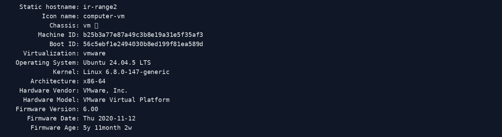

**Evidence: UTC time record**

**Evidence: Running Docker containers**

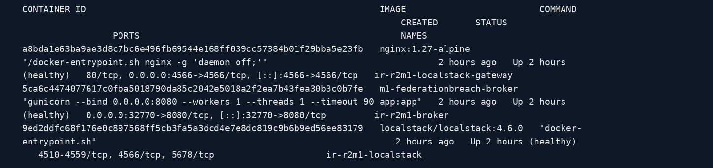

**Evidence: Range 1 handoff certificate verification**

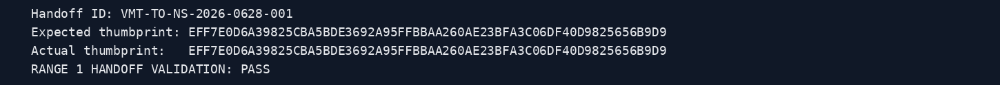

## 3. Establish the pre-incident baseline

Historical baseline records identify `maya.shah@vantage.example` from `127.0.0.1`, with accepted AWS, Azure and GCP federation assertions. The baseline Lambda health-check succeeded. The current administrative status image was collected **after** containment and must not be mistaken for a pre-incident snapshot.

**Evidence: Gateway health**

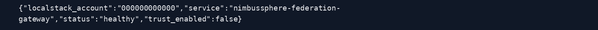

**Evidence: Baseline federation authentication**

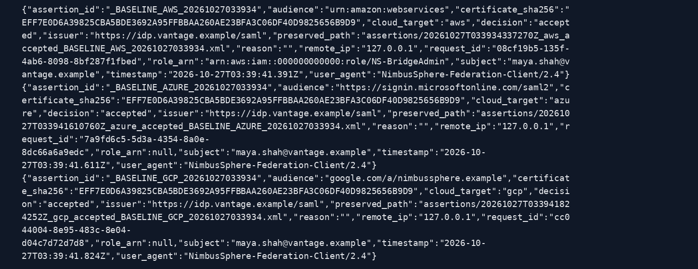

**Evidence: Baseline AWS STS activity**

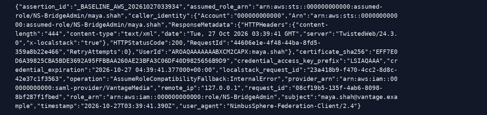

**Evidence: Baseline Lambda activity**

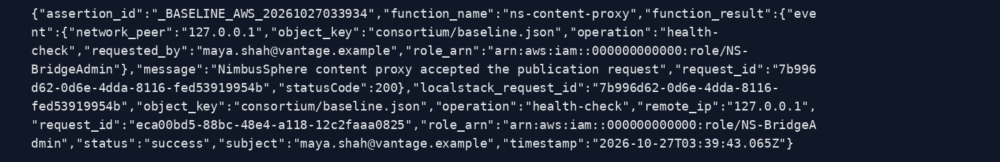

**Evidence: Current administrative status (post-containment, not historical baseline)**

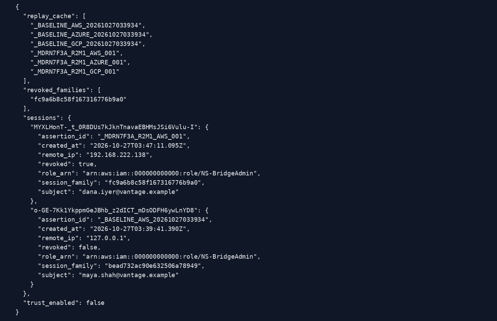

## 4. Detection and initial triage

Incident records show `dana.iyer@vantage.example` authenticating from observed peer `192.168.222.138`. AWS, Azure and GCP incident assertions share marker `MDRN7F3A_R2M1`. The peer is based on audit logs, not an assumed static address.

**Evidence: Incident federation authentication records**

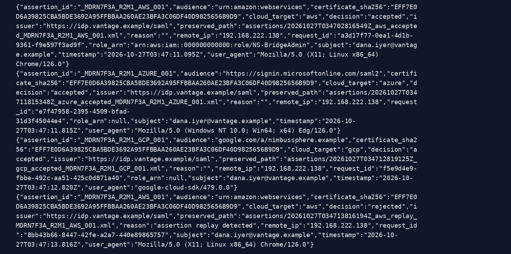

**Evidence: Incident activity summary**

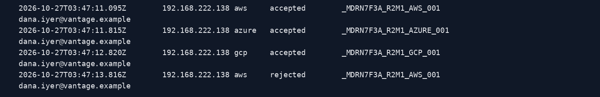

## 5. Validate signed SAML artefacts

Four incident assertion XML files passed signature verification against the trusted certificate: AWS accepted, Azure accepted, GCP accepted and AWS replay. A valid signature establishes cryptographic validity against the configured certificate; it does not establish legitimate use of that identity.

**Evidence: SHA-256 hashes of preserved assertion XMLs**

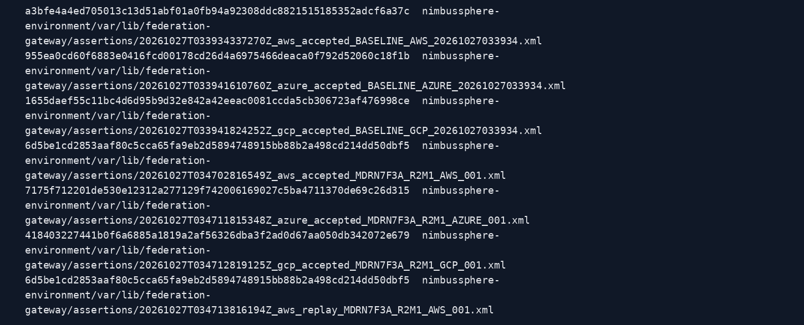

**Evidence: Signature verification of all four incident assertions**

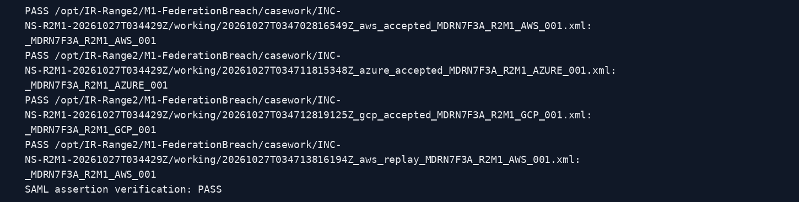

## 6. Confirm AWS session issuance

AWS assertion `_MDRN7F3A_R2M1_AWS_001` was accepted at `2026-10-27T03:47:11.095Z`. The LocalStack audit indicates role `NS-BridgeAdmin`, assumed-role ARN `arn:aws:sts::000000000000:assumed-role/NS-BridgeAdmin/dana.iyer`, source `192.168.222.138` and certificate fingerprint matching the Range 1 handoff.

The STS operation is recorded as `AssumeRoleCompatibilityFallback:InternalError`. This is a LocalStack lab compatibility fallback, **not evidence of a production AWS compromise**. The LocalStack STS request ID is `04076027-5178-44fe-8fc1-f16eb5dd1945`; caller-identity response request ID `00b74b27-ee3e-484e-9485-3051afbfaaa3`; gateway request ID `a3d17f77-0ea1-4d1b-9361-f9e597f3ad9f`.

**Evidence: AWS STS operation and assumed-role identity**

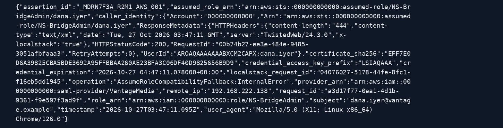

## 7. Confirm workload use

At `2026-10-27T03:47:11.155Z`, the assertion-derived AWS session invoked `ns-content-proxy` successfully. The operation was `publish`, targeting `consortium/emergency-branding.json`, and the function returned status code `200`. LocalStack Lambda request ID: `b87788b8-4200-401f-8ff3-6eb96ba291a9`. Gateway request ID: `210d0b98-bacc-4f22-b75a-c4cc0fe701d3`.

**Evidence: Successful Lambda publication event**

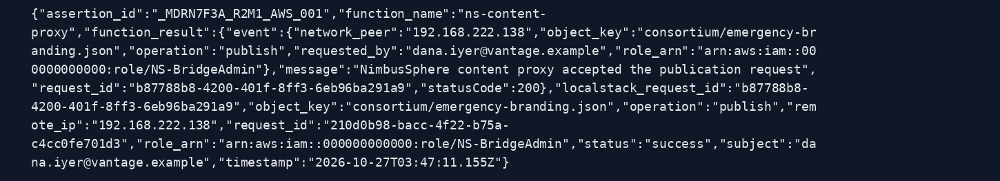

## 8. Confirm replay activity

The same AWS assertion was replayed at `2026-10-27T03:47:13.816Z` and was rejected. A `SAML_ASSERTION_REPLAY` security event was recorded for the same identity and peer, with request ID `8bb43b66-8447-42fe-a2a7-440e89865757`. HTTP records provide supporting network context.

**Evidence: SAML assertion replay detection**

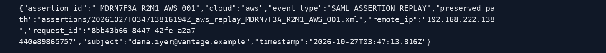

**Evidence: HTTP access records from the observed incident peer**

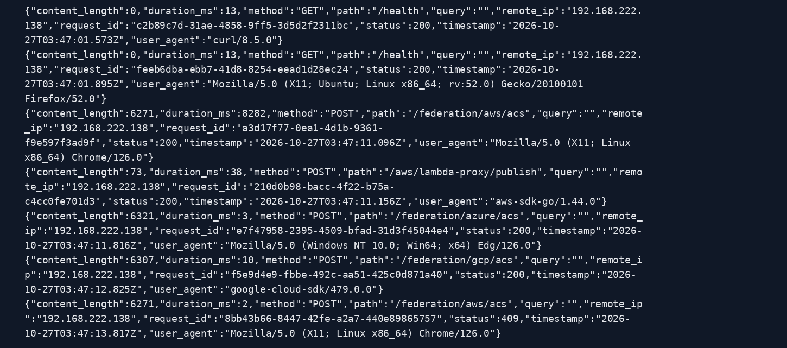

## 9. Reconstruct the incident timeline

| Time (UTC, 27 Oct 2026) | Verified event |
|---|---|
| 03:39:41 | Historical baseline AWS, Azure and GCP activity |
| 03:47:11.095 | AWS incident assertion accepted; STS session recorded |
| 03:47:11.155 | Lambda publication succeeded |
| 03:47:11.815 | Azure assertion accepted |
| 03:47:12.820 | GCP assertion accepted |
| 03:47:13.816 | AWS assertion replay detected and rejected |
| 05:37:12.094 | Incident session family revoked |
| 05:37:31.038 | Federation trust disabled |
| 05:40:18.438 | Invalid-token access request denied and logged |

The generated CSV is the full source of the reconstructed sequence; the table above summarises the principal events.

**Evidence: Generated incident timeline**

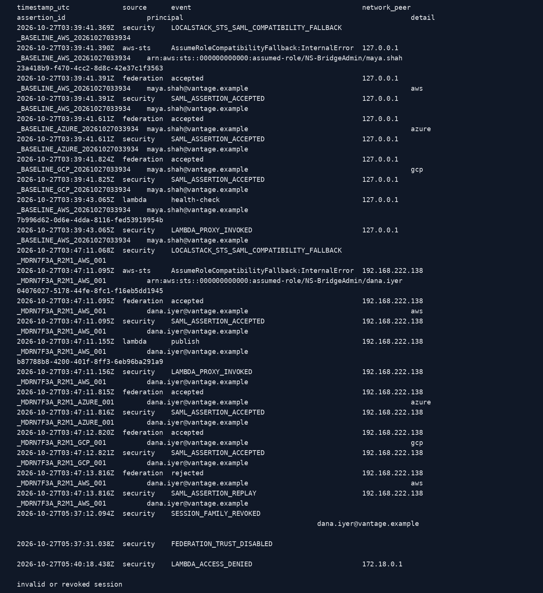

## 10. Scope and impact

Identity correlation shows AWS, Azure and GCP SAML assertions accepted for `dana.iyer@vantage.example` from `192.168.222.138`. **One successful AWS Lambda call** is established. Acceptance of Azure and GCP assertions must not be presented as proof of downstream provider-native workload activity.

**Evidence: Cross-provider identity and assertion correlation**

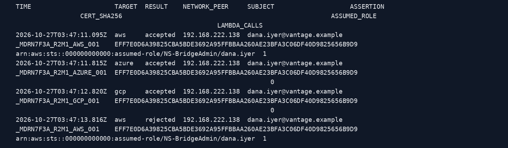

## 11. Preserve pre-containment evidence

The previously collected pre-containment archive and containment records were locally hashed and their checksums verified. This establishes agreement with the recorded hashes at verification time, not independent chain-of-custody completeness.

**Evidence: Five containment evidence files: checksum verification**

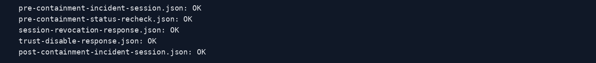

**Evidence: Earlier containment archive: SHA-256 verification**

## 12. Containment actions

The administrative API revoked the session family `fc9a6b8c58f167316776b9a0` at `05:37:12.094Z` and disabled VantageMedia federation trust at `05:37:31.038Z`. Subsequent state reported `trust_enabled: false` and `revoked: true` for the incident session. The source audit events support these transitions; no additional mutation is required.

**Evidence: Preserved revocation and trust-state verification**

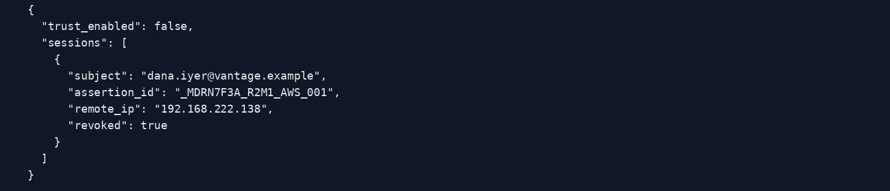

## 13. Eradication and recovery validation

The gateway remained healthy with trust disabled; LocalStack IAM, STS, Lambda, S3 and Logs were running. An intentionally invalid bearer token received HTTP `401` and generated `LAMBDA_ACCESS_DENIED`. This tested rejection of an invalid token, **not** the original incident token. Do not re-enable the trust before signing-key/certificate rotation and independent approval.

**Evidence: Post-containment administrative state**

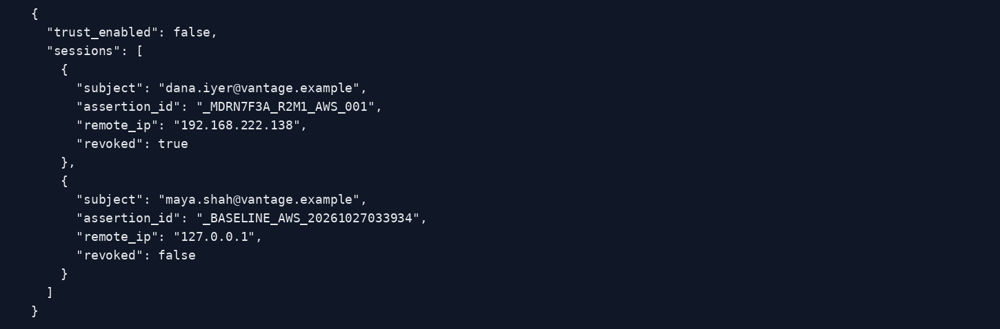

**Evidence: Gateway health after containment**

**Evidence: LocalStack services after containment**

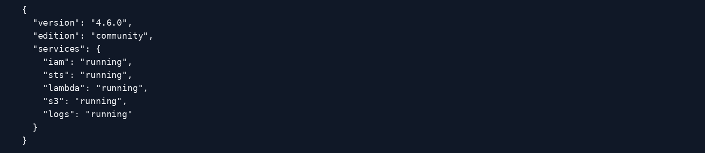

## 14. Post-containment comparison and evidence collection

The security log records `SESSION_FAMILY_REVOKED`, `FEDERATION_TRUST_DISABLED` and `LAMBDA_ACCESS_DENIED`. The official post-containment collector produced an evidence set whose checksum verification returned `OK` for the listed files. The images document the collector output; raw files and hash manifests remain definitive.

**Evidence: Containment and access-denial audit events**

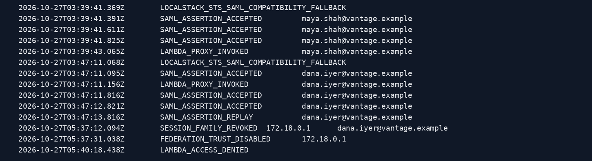

**Evidence: Full post-containment evidence checksum verification**

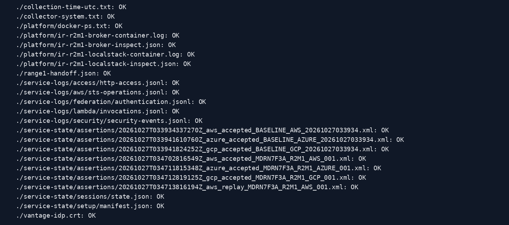

## 15. Final findings, archive and M2 handoff

The `final-m1-evidence.tar.gz` archive passed the local `sha256sum -c` verification. The **exact final archive fingerprint** was not visible in the supplied summary and should be copied from `final-m1-evidence.sha256` before formal handoff. The image of final verification was generated after the archive, so it may not be included inside that archive.

**Evidence: Final M1 archive checksum verification**

### Verified M2 handoff details

| Field | Value |
|---|---|
| Affected subject | `dana.iyer@vantage.example` |
| Observed incident network peer | `192.168.222.138` |
| Trusted federation provider | `arn:aws:iam::000000000000:saml-provider/VantageMedia` |
| Initial role | `NS-BridgeAdmin` |
| Session principal | `arn:aws:sts::000000000000:assumed-role/NS-BridgeAdmin/dana.iyer` |
| Campaign marker | `MDRN7F3A_R2M1` |
| AWS assertion | `_MDRN7F3A_R2M1_AWS_001` |
| Azure assertion | `_MDRN7F3A_R2M1_AZURE_001` |
| GCP assertion | `_MDRN7F3A_R2M1_GCP_001` |
| Handoff certificate SHA-256 | `EFF7E0D6A39825CBA5BDE3692A95FFBBAA260AE23BFA3C06DF40D9825656B9D9` |
| STS LocalStack request ID | `04076027-5178-44fe-8fc1-f16eb5dd1945` |
| Lambda LocalStack request ID | `b87788b8-4200-401f-8ff3-6eb96ba291a9` |
| Workload target | `consortium/emergency-branding.json` |
| Original incident token retested? | No |

### Remaining formal sign-off items

1. Attach the exact final M1 archive SHA-256 fingerprint from its manifest.
2. Record investigator, custody timestamps, archive transfer recipient and receipt acknowledgement.
3. Store this report alongside the original forensic outputs and the final archive in a separately hashed handoff package.
4. Restrict access to any files containing authentication material, secrets or session identifiers.

**Scope limitation:** The supplied evidence supports the LocalStack training incident, not compromise of real AWS, Azure or GCP production environments.

