# IR-Range2 M2 Blue Team Writeup - Role Hop Maze

> **Publication note:** This GitHub copy contains the Blue solution and supplied images. References to raw summaries, handoff JSON, analysis artifacts, archive inventories and original hash manifests describe the original supplied ZIP or lab casework; those supporting files are not included in this copy.

## Case overview

- **Case ID:** IR-R2M2-20261027T080100Z
- **Scenario:** IR-Range2 M2 Role Hop Maze
- **Chain ID:** NS-R2M2-CHAIN-15
- **Observed network origin:** 192.168.222.138
- **Initial role:** NS-BridgeAdmin
- **Final compromised role:** CICD-AdministrationRole
- **Vulnerable hop:** 8
- **Containment status:** contained
- **Recovery validation:** PASS

> Note: the simulation was executed from the Ubuntu target itself, so the recorded network origin reflects the target VM address rather than a separate attack VM.

## Executive summary

The M2 incident was successfully reproduced and investigated. A release-automation request submitted to NimbusSphere's cloud access service triggered a **15-hop AWS IAM role chain** beginning at `NS-BridgeAdmin` and ending at `CICD-AdministrationRole`. The decisive weakness occurred at **hop 8**, where the `ArtifactPromotion` trust policy accepted an overbroad principal pattern and a permissive external ID format (`ns-*`), allowing `AutomationDispatcher` to assume the role using the attacker-supplied external ID `ns-shadow-4821` rather than the approved `ns-artifact-7b91`.

After reaching `CICD-AdministrationRole`, the incident performed two material cloud actions:

1. `GetSecretValue` against `nimbussphere/prod/azure-release-webhook`
2. `PutObject` to `s3://ns-cicd-control/deploy-queue/ghost-trigger-request.json`

Containment was applied by hardening the `ArtifactPromotion` trust policy to require the approved external ID, restricting the trusted principal, and revoking session records. Post-containment recovery validation passed, service health remained healthy, and an M2-to-M3 handoff was generated.

## Section 04 - Attack validation

The official target-side validation confirmed the role-hop scenario completed successfully, observed 15 role transitions, and ended at `CICD-AdministrationRole`.

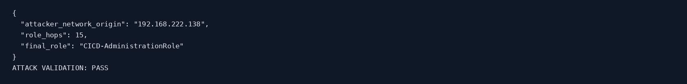

## Section 05 - Role-chain reconstruction

The reconstructed chain showed **15 successful STS hops**. The first successful hop was from `NS-BridgeAdmin` to `CustomerSupportReadOnly` at `2026-10-27T08:02:28.715Z`. The final hop was from `ProductionDeploymentManager` to `CICD-AdministrationRole` at `2026-10-27T08:02:30.833Z`.

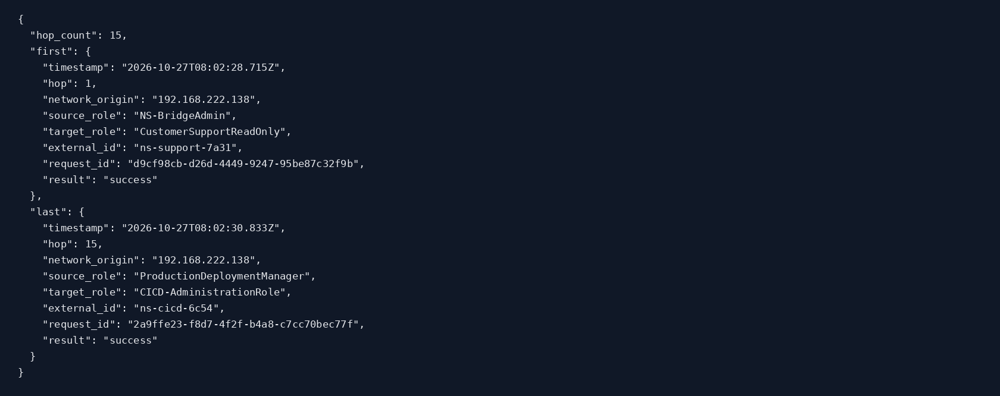

## Section 06 - Complete 15-hop path

The full path established from the evidence is:

| Hop | Source role | Target role | External ID |
|---:|---|---|---|
| 1 | NS-BridgeAdmin | CustomerSupportReadOnly | `ns-support-7a31` |
| 2 | CustomerSupportReadOnly | TenantAuditViewer | `ns-audit-9c42` |
| 3 | TenantAuditViewer | BillingCaseReviewer | `ns-billing-5d18` |
| 4 | BillingCaseReviewer | BackupMetadataReader | `ns-backup-6e27` |
| 5 | BackupMetadataReader | DataLakeCatalogReader | `ns-catalog-8f34` |
| 6 | DataLakeCatalogReader | ReleaseMonitor | `ns-release-2b90` |
| 7 | ReleaseMonitor | AutomationDispatcher | `ns-automation-4c61` |
| 8 | AutomationDispatcher | ArtifactPromotion | `ns-shadow-4821` |
| 9 | ArtifactPromotion | BuildCacheAdministrator | `ns-build-1a44` |
| 10 | BuildCacheAdministrator | RegistryReplication | `ns-registry-3f02` |
| 11 | RegistryReplication | ClusterBootstrapOperator | `ns-cluster-8d20` |
| 12 | ClusterBootstrapOperator | CustomerPlatformOperator | `ns-platform-4e17` |
| 13 | CustomerPlatformOperator | SharedServicesAutomation | `ns-shared-5a62` |
| 14 | SharedServicesAutomation | ProductionDeploymentManager | `ns-prod-9b73` |
| 15 | ProductionDeploymentManager | CICD-AdministrationRole | `ns-cicd-6c54` |

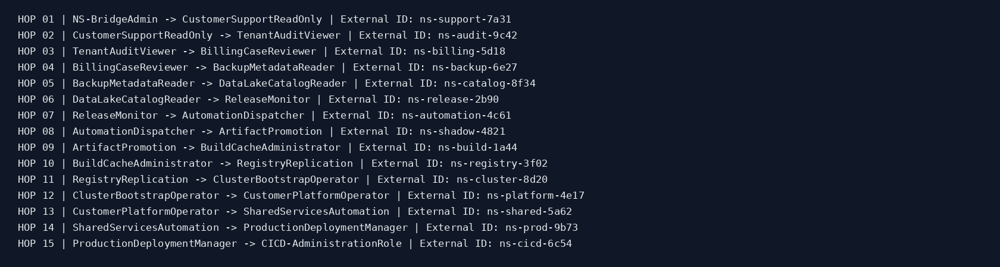

## Section 07 - Trust gap analysis at hop 8

The key control failure occurred at **hop 8**:

- **Source role:** `AutomationDispatcher`
- **Target role:** `ArtifactPromotion`
- **Observed external ID:** `ns-shadow-4821`
- **Approved external ID:** `ns-artifact-7b91`
- **Detection rule:** `overbroad-role-trust-used`

The trust evaluation passed because:

- `aws:PrincipalArn` matched the broad pattern `arn:aws:iam::*:role/accounts/*/*Automation*`
- `sts:ExternalId` was checked with `StringLike` against `ns-*`, which incorrectly allowed `ns-shadow-4821`
- the tenant principal tag matched the expected tenant

This made the trust policy too broad for a sensitive role transition.

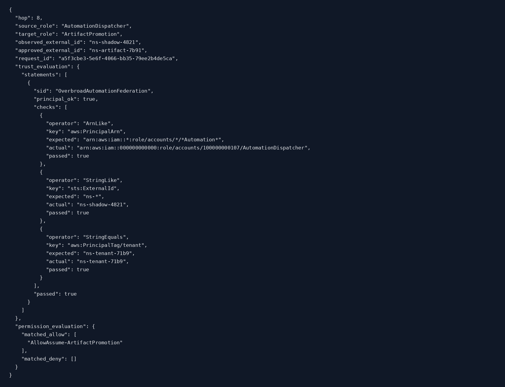

## Section 08 - Original IAM trust policy evidence

The pre-containment IAM evidence captures the original trust configuration around the relevant roles, including `AutomationDispatcher` and `ArtifactPromotion`.

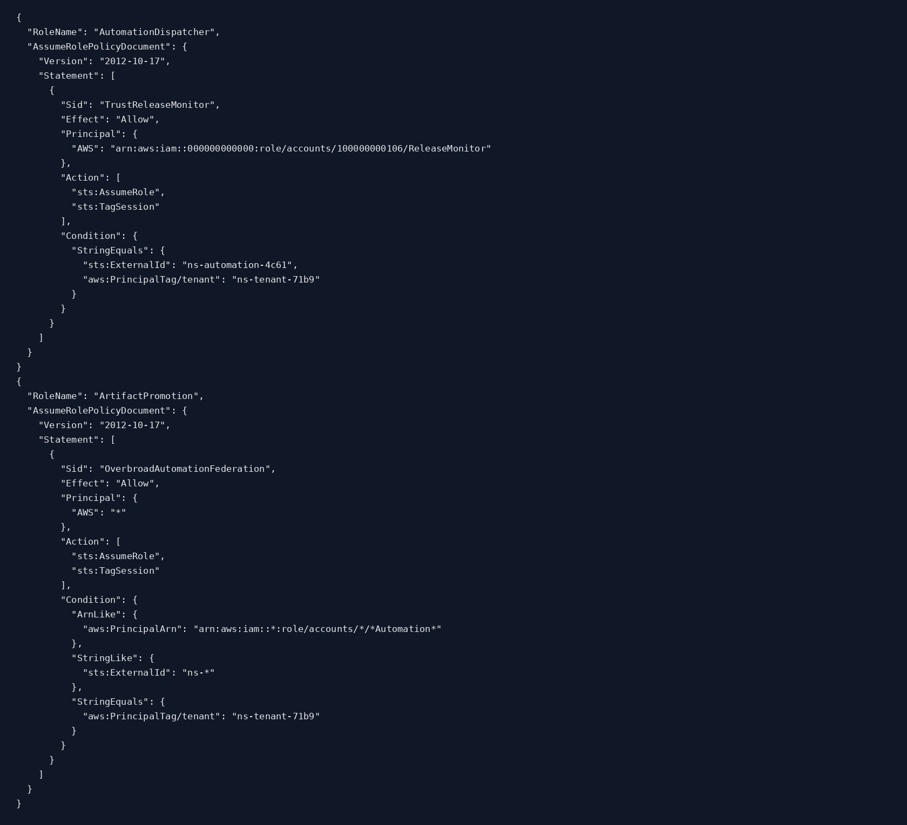

## Section 09 - Incident timeline

The incident timeline shows the role assumptions unfolding between **08:02:28Z** and **08:02:31Z** on 27 October 2026, with the detection firing immediately after hop 8. The initial federation handoff assumed `NS-BridgeAdmin`, followed by 15 chained `AssumeRole` calls.

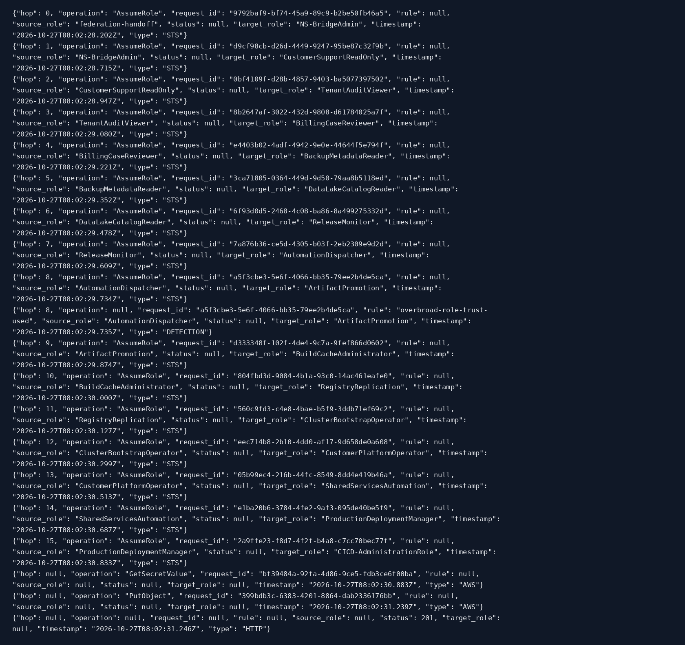

## Section 10 - Final cloud actions

After achieving the final CI/CD role, the incident performed two cloud actions:

| Timestamp (UTC) | Service | Operation | Resource | Result |
|---|---|---|---|---|
| 2026-10-27T08:02:30.883Z | secretsmanager | GetSecretValue | `nimbussphere/prod/azure-release-webhook` | success |
| 2026-10-27T08:02:31.239Z | s3 | PutObject | `s3://ns-cicd-control/deploy-queue/ghost-trigger-request.json` | success |

These actions indicate secret retrieval and deployment-queue manipulation consistent with the scenario objective.

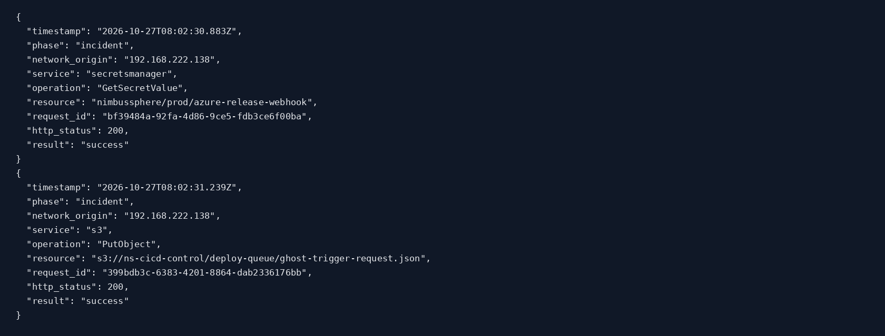

## Section 11 - Security detections

A high-severity detection fired at hop 8 when the overbroad trust was used.

| Timestamp (UTC) | Rule | Severity | Hop | Source role | Target role |
|---|---|---|---:|---|---|
| 2026-10-27T08:02:29.735Z | `overbroad-role-trust-used` | high | 8 | AutomationDispatcher | ArtifactPromotion |

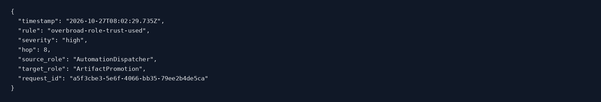

## Section 12 - Incident summary and impact

The incident summary recorded the following key impact artefacts:

- **Final role:** `CICD-AdministrationRole`
- **Azure webhook name:** `release-reconcile-hook`
- **Logic app name:** `ns-release-sync-prod`
- **Kubernetes namespace:** `nimbus-cicd-prod`
- **Service account:** `ns-release-bot`
- **Deployment request ID:** `release-04eb1111b160`
- **Status:** `incident-complete`

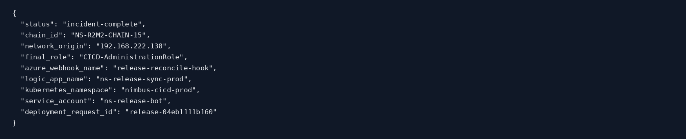

## Section 13 - Containment action

Official containment was applied at `2026-10-27T08:07:19.663Z`. The response hardened the vulnerable trust edge and revoked active session records.

Primary containment outcomes:

- **Hardened role:** `ArtifactPromotion`
- **Trusted principal:** `arn:aws:iam::000000000000:role/accounts/100000000107/AutomationDispatcher`
- **Required external ID:** `ns-artifact-7b91`
- **Revoked session records:** `16`
- **Revocation cutoff:** `2026-10-27T08:07:19.411Z`

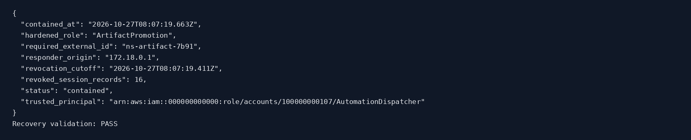

## Section 14 - Recovery validation

The repository recovery validation reported **PASS**, confirming the environment was successfully remediated according to the official procedure.

## Section 15 - Containment status record

The persisted containment status confirms the scenario state as `contained` and records the remediation details.

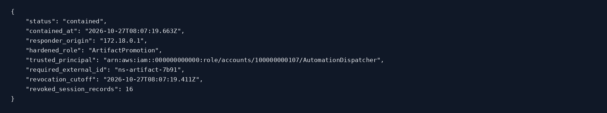

## Section 16 - Hardened IAM trust evidence

Post-containment IAM evidence shows the `ArtifactPromotion` trust policy after hardening. This is the authoritative proof that the vulnerable trust relationship was changed.

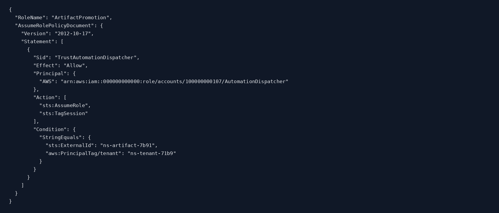

## Section 18 - Post-containment integrity verification

Post-containment evidence integrity verification succeeded. The known collector issue remains that the `SHA256SUMS` file should not be self-verified; all other evidence entries were verified successfully.

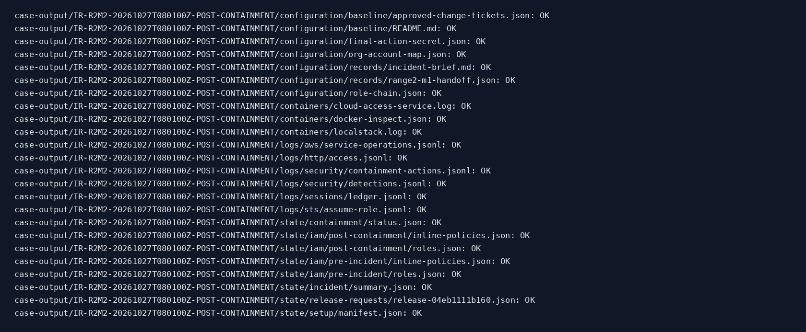

## Section 19 - Service health

After containment and recovery, the business application remained healthy:

- **Service:** `nimbussphere-cloud-access-service`
- **Setup ready:** `True`
- **Status:** `healthy`

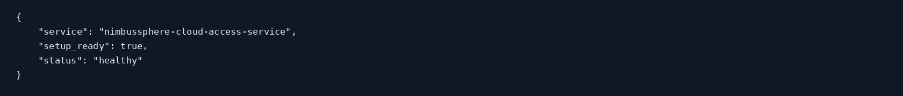

## Section 20 - M2 to M3 handoff

The scenario generated the following structured handoff:

- **Handoff ID:** `NS-R2M2-TO-R2M3-2026-0628-001`
- **Created at:** `2026-10-27T08:07:22.931544+00:00`
- **Source scenario:** `IR-Range2-M2`
- **SHA-256:** `2cd86b5964b3815256ce864ffa69aaf50f8d89256f3de5fd1488329769c3406c`

Handoff findings:

- compromised CI/CD role: `CICD-AdministrationRole`
- attacker network origin: `192.168.222.138`
- Azure webhook name: `release-reconcile-hook`
- Logic app name: `ns-release-sync-prod`
- Kubernetes namespace: `nimbus-cicd-prod`
- service account: `ns-release-bot`
- campaign marker: `MDRN-7F3A`
- deployment request ID: `release-04eb1111b160`

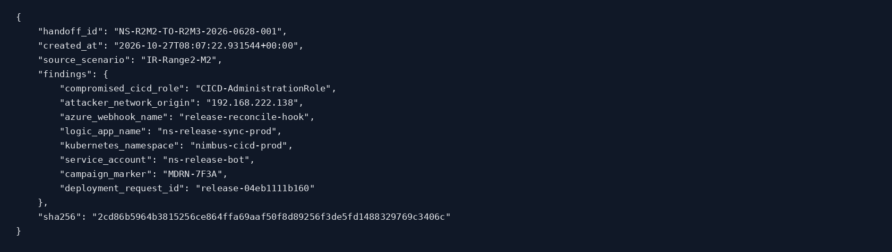

## Conclusions

M2 is **complete** from a blue-team perspective. The investigation established the full 15-hop role chain, the precise trust-policy weakness at hop 8, the resulting CI/CD-level access, the concrete cloud actions taken by the incident, and the successful remediation state.

### Final findings

1. The compromise path relied on chained IAM role assumptions, not a single excessive permission.
2. The decisive weakness was an **overbroad trust policy** on `ArtifactPromotion` that accepted an arbitrary `ns-*` external ID.
3. The attacker reached `CICD-AdministrationRole` and performed both **secret retrieval** and **deployment queue modification**.
4. Detection logic identified the trust misuse at hop 8.
5. Official containment hardened the trust relationship and revoked the affected sessions.
6. Recovery validation passed and the service remained healthy.
7. The next scenario handoff for M3 was generated successfully.

## Included evidence

The original supplied ZIP includes:

- the Markdown writeup
- 16 cleaned evidence screenshots
- raw text outputs
- role-chain reconstruction artefacts
- the generated M3 handoff JSON
- integrity hashes for the investigation bundle
