# IR-Range2 M3: Serverless Ghost

> **Publication note:** This GitHub copy contains the Blue solution and supplied images. References to raw summaries, handoff JSON, analysis artifacts, archive inventories and original hash manifests describe the original supplied ZIP or lab casework; those supporting files are not included in this copy.

**Blue Team investigation and incident-response writeup**  
**Case ID:** IR-R2M3-20261027T082610Z  
**Investigation date:** 27 October 2026 (all event times UTC)  
**Application:** `ns-release-sync-prod`  
**Disposition:** Contained; recovery validated  
**Evidence source:** Uploaded M3 investigation ZIP, 17 PNG screenshots, 40 integrity-checked evidence files

## 1. Executive summary

The NimbusSphere Release Automation training scenario progressed from the M2 compromise of `CICD-AdministrationRole` to an unauthorised serverless workflow deployment. An actor using that role deployed `release-reconcile-hook` via the SCM-compatible zip deployment API. No approved change ID or matching package allow-list entry existed. The deployed workflow was invoked and executed five actions, including issuing a short-lived bootstrap JWT, submitting a downstream job and deleting that JWT.

The service recorded a completed run (`c5eb7dda-4cb9-43f0-93b1-8a9f66ade294`) and a temporary token with JTI `caa1148e-4dab-4935-9623-12f56f758080`. Its lifecycle and downstream effects remain evidenced even though the JWT file was deleted. The detection engine recorded two **high-severity** findings: unapproved workflow deployment and creation of a transient cluster credential by that workflow.

The responder quarantined the malicious workflow definition, disabled deployment credentials and blocked the recorded source. The recovery checks all returned `true`; both legitimate workflows remained present and the application was healthy afterward. An M3-to-M4 handoff carries the short-lived credential and Kubernetes job correlation identifiers.

> **Attribution limitation:** The observed source `192.168.222.138` is the Ubuntu target VM itself because the authorised attack simulation was executed locally. It must not be presented as independent external attacker infrastructure. The simulated environment provides application, HTTP, filesystem, token lifecycle and job-submission records, not native Azure Activity or Logic Apps provider logs.

## 2. Scope, objectives and findings

| Investigation question | Evidence-supported result |
|---|---|
| Was a new workflow deployed? | Yes: `release-reconcile-hook` |
| Was deployment authorised? | No: change ID absent, deployment ID and package hash not allow-listed |
| Was it invoked? | Yes: successful run `c5eb7dda-4cb9-43f0-93b1-8a9f66ade294` |
| Did it create a token? | Yes: `TokenCreated` and `TokenDeleted` records, with matching JTI and hash |
| Did it submit a downstream job? | Yes: incident summary and M4 handoff name `release-index-refresh-7f3a`; further cluster-side verification belongs to M4 |
| Did detection identify the activity? | Yes: two high-severity rules |
| Was the workflow contained? | Yes: quarantined; origin blocked; deployment credential disabled |
| Did recovery validation pass? | Yes: eight of eight recorded checks passed |

## 3. Initial validation

Official `validate-attack.sh` returned `ATTACK VALIDATION: PASS`. The simulation exercised the deployment endpoint, the request trigger, and the resulting workflow/token chain.

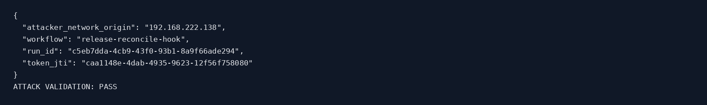

## 4. Unapproved deployment: policy gap

The application received a deployment for workflow `release-reconcile-hook` as actor `CICD-AdministrationRole`.

| Field | Evidence |
|---|---|
| Deployment ID | `ghost-5eec61ad-9d70-4eb9-98dc-0efb87fbd4a1` |
| Actor | `CICD-AdministrationRole` |
| Workflow | `release-reconcile-hook` |
| Change ID | Missing (`null`) |
| Deployment approved | `false` |
| Package approved | `false` |
| Package SHA-256 | `72ff47c1ddeee8065f25ba0bd47f6edb47ce5135863c9d16674334614781cac2` |

The deployment wrote `connections.json`, `parameters.json` and `workflow.json` beneath the ghost workflow directory. The missing change authorisation and digest match make this a concrete unauthorised package deployment, not merely an unexpected workflow name.

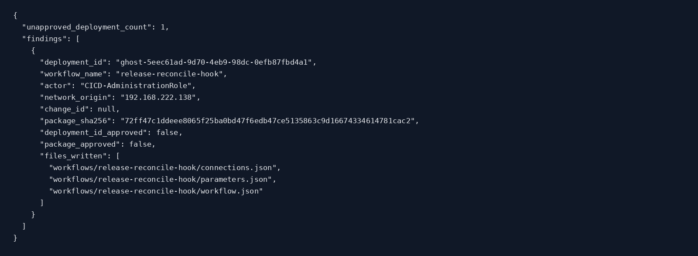

## 5. Workflow reconstruction

The deployed workflow exposed a manual trigger, with actions chained in the following order:

| Order | Action | Type | Purpose |
|---:|---|---|---|
| 1 | `Validate_Release_Request` | `ParseJson` | Parse and validate the supplied release request |
| 2 | `Issue_Bootstrap_Token` | `Http` | Create a temporary bootstrap credential |
| 3 | `Start_Deployment_Job` | `Http` | Submit the downstream deployment job |
| 4 | `Revoke_Bootstrap_Token` | `Http` | Delete or revoke the temporary credential |
| 5 | `Response` | `Response` | Return the workflow response |

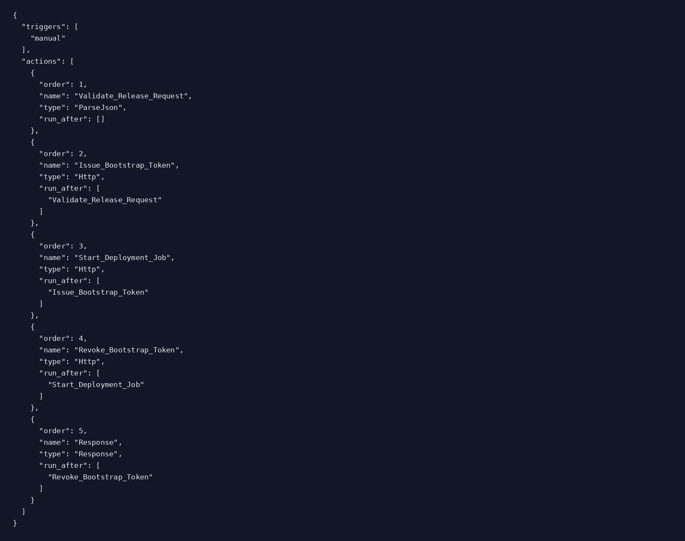

## 6. Incident summary and correlation keys

The incident summary records completion at `2026-10-27T08:26:24.610Z` with the following keys:

| Indicator | Value |
|---|---|
| Campaign marker | `MDRN-7F3A` |
| Correlation ID | `923cb549-8dec-4ef2-b179-daadfd870730` |
| Run ID | `c5eb7dda-4cb9-43f0-93b1-8a9f66ade294` |
| Release ID | `rel-shadow-7f3a-042` (workflow run log) |
| Kubernetes namespace | `nimbus-cicd-prod` |
| Service account | `ns-release-bot` |
| Bootstrap secret | `ns-bootstrap-7f3a` |
| Downstream job | `release-index-refresh-7f3a` |

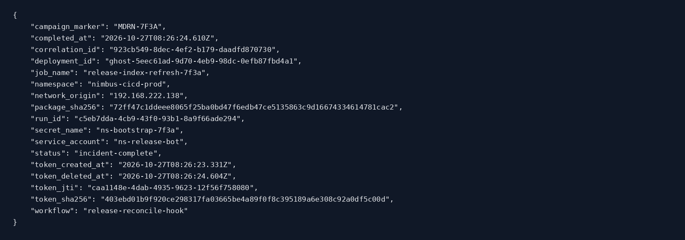

## 7. HTTP activity and deployment record

| Event time (UTC) | Method | Endpoint | HTTP status | Socket peer |
|---|---|---|---|---|
| 2026-10-27T08:26:22.175Z | `POST` | `/scm/api/zipdeploy` | 202 | `192.168.222.138` |
| 2026-10-27T08:26:24.625Z | `POST` | `/api/release-reconcile-hook/triggers/manual/invoke` | 202 | `192.168.222.138` |

Both requests originated from the observed Ubuntu VM address. HTTP `202` means the server accepted these operations, while the independent run and lifecycle records establish their actual completion.

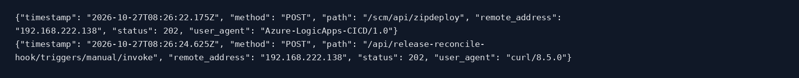

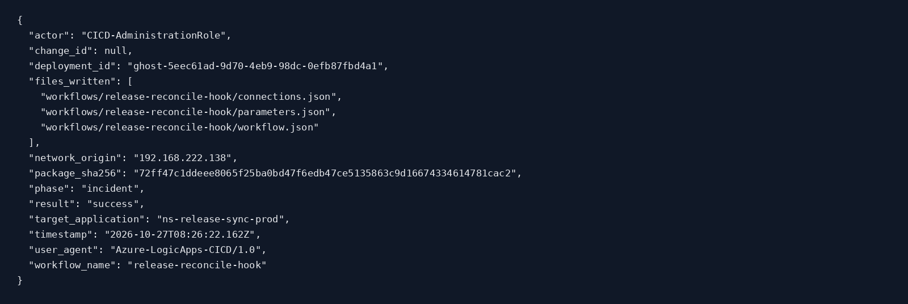

## 8. Execution and workflow action evidence

The incident workflow started at `2026-10-27T08:26:23.168Z` and completed at `2026-10-27T08:26:24.610Z` with status **Succeeded**. The recorded duration was **1441 ms**.

All recorded action names match the reconstructed definition. The action sequence and run IDs provide strong correlation between the deployment, trigger and ensuing token lifecycle.

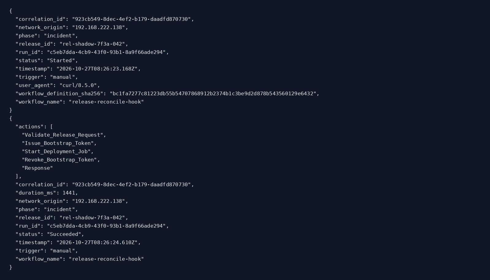

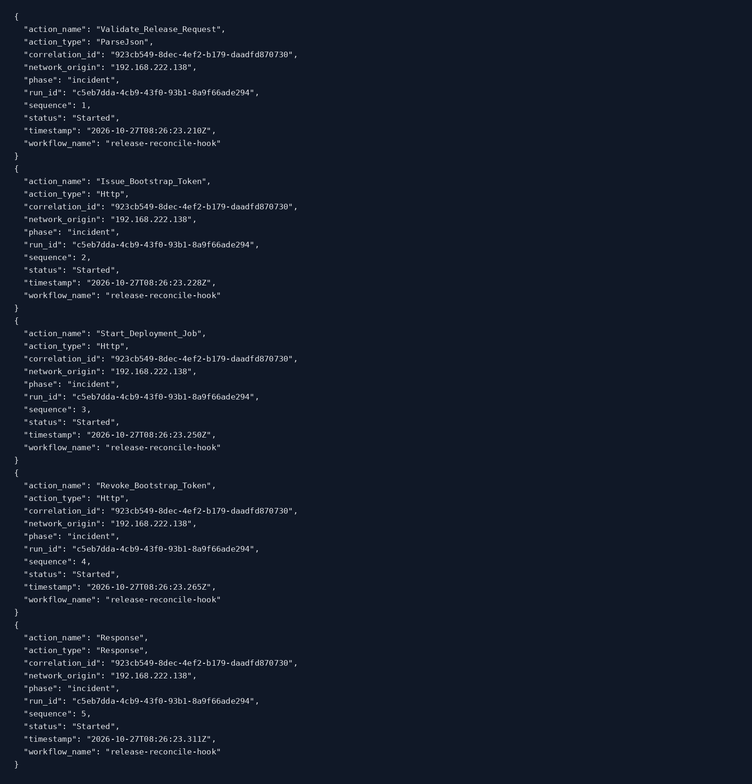

## 9. Transient JWT lifecycle

The temporary bootstrap token was created at `2026-10-27T08:26:23.331Z` and deleted at `2026-10-27T08:26:24.604Z`. The creation and deletion events have the same JTI and SHA-256 digest:

- **JTI:** `caa1148e-4dab-4935-9623-12f56f758080`
- **SHA-256:** `403ebd01b9f920ce298317fa03665be4a89f0f8c395189a6e308c92a0df5c00d`
- **Secret identifier:** `ns-bootstrap-7f3a`
- **Namespace/service account:** `nimbus-cicd-prod` / `ns-release-bot`
- **Recorded expiration:** `2026-10-27T08:26:27.331Z`

The deleted JWT file was verified absent from the runtime. **File deletion is not equivalent to absence of compromise:** the lifecycle records preserve proof of credential creation and removal, while M4 should determine what Kubernetes actions were completed within that brief lifetime.

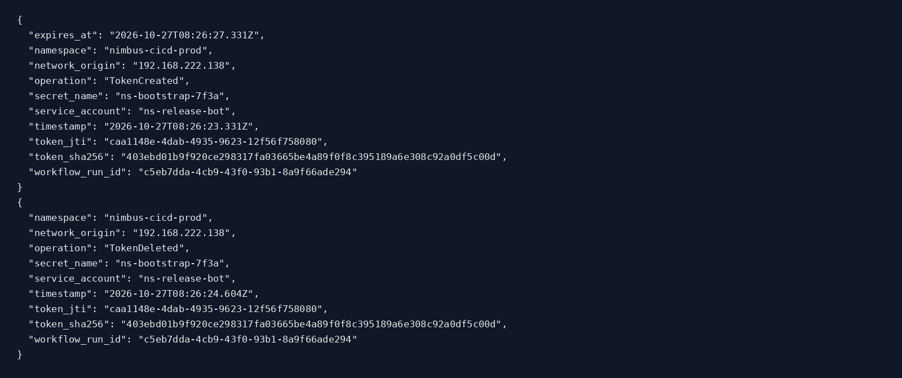

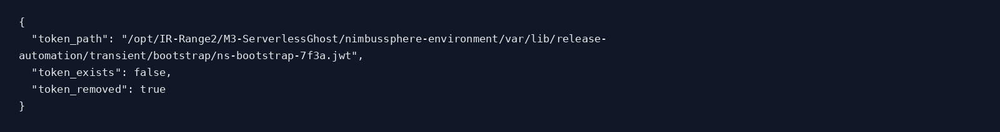

## 10. Detection coverage

Two high-severity rules fired:

| Detection timestamp (UTC) | Rule | Meaning |
|---|---|---|
| 2026-10-27T08:26:22.162Z | `unapproved-workflow-package-deployment` | No approved change ID or package allow-list entry matched the deployment |
| 2026-10-27T08:26:24.610Z | `unapproved-workflow-issued-transient-cluster-credential` | Unapproved workflow issued a transient cluster credential |

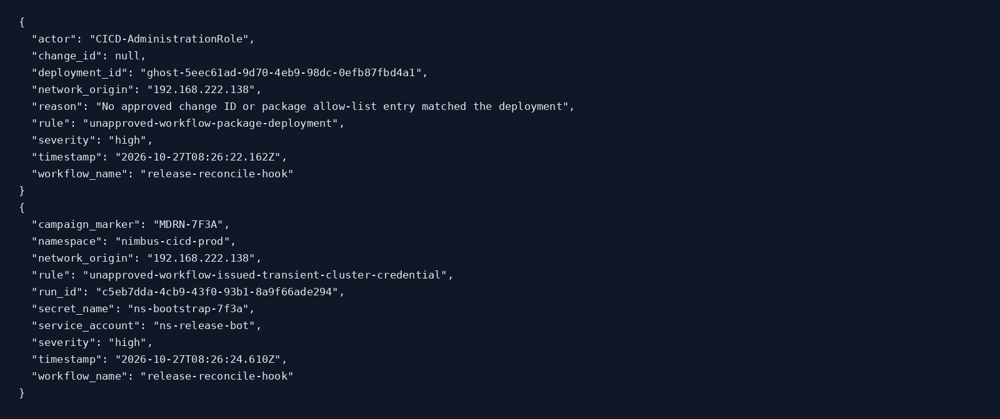

## 11. Deployed-file integrity and forensic preservation

The investigation hashed the installed workflow files. Their raw SHA-256 entries are retained with the report package. The original pre-containment evidence was separately collected and verified in the Ubuntu VM before any containment changes. The uploaded ZIP contains investigative outputs and images, **not the full original TAR archives**, which remain on the VM.

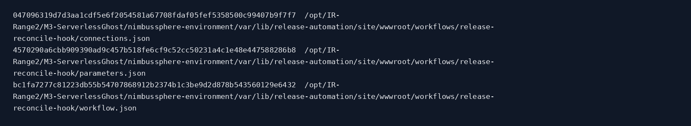

## 12. Containment actions

Containment was recorded at `2026-10-27T08:28:46.302Z` and marked `contained`. The response:

- Quarantined the ghost workflow under `quarantine/release-reconcile-hook-20261027T082846301804Z`.
- Disabled the deployment credential (`deployment_credential_enabled: false`).
- Blocked the observed source address `192.168.222.138`.
- Preserved HTTP access, deployment, workflow run/action, token lifecycle, job-submission and incident-summary evidence.

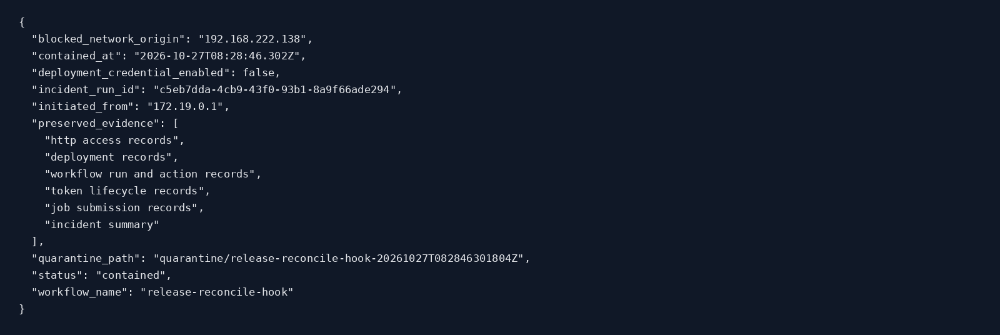

## 13. Recovery and service availability

The recovery endpoint recorded `recovery_validated: true` at `2026-10-27T08:28:47.120Z`. All eight controls passed:

| Validation control | Result |
|---|---|
| `attacker_origin_blocked` | PASS |
| `contained` | PASS |
| `definition_quarantined` | PASS |
| `deployment_credential_disabled` | PASS |
| `ghost_workflow_removed` | PASS |
| `release_audit_present` | PASS |
| `release_notify_present` | PASS |
| `transient_token_absent` | PASS |

The application health endpoint remained `healthy` with `setup_ready: true`. No claim is made about systems outside the local M3 training service.

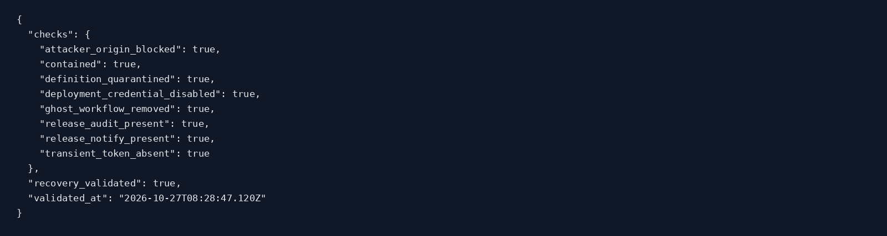

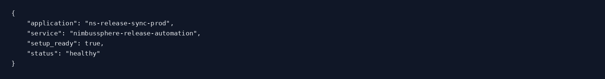

## 14. Post-containment evidence integrity

The post-containment evidence collector completed, the ZIP includes its verification output, and the collection records and screenshot hashes were checked. The `M3-INVESTIGATION-SHA256SUMS` manifest was also checked independently against the 40 other files in the supplied ZIP.

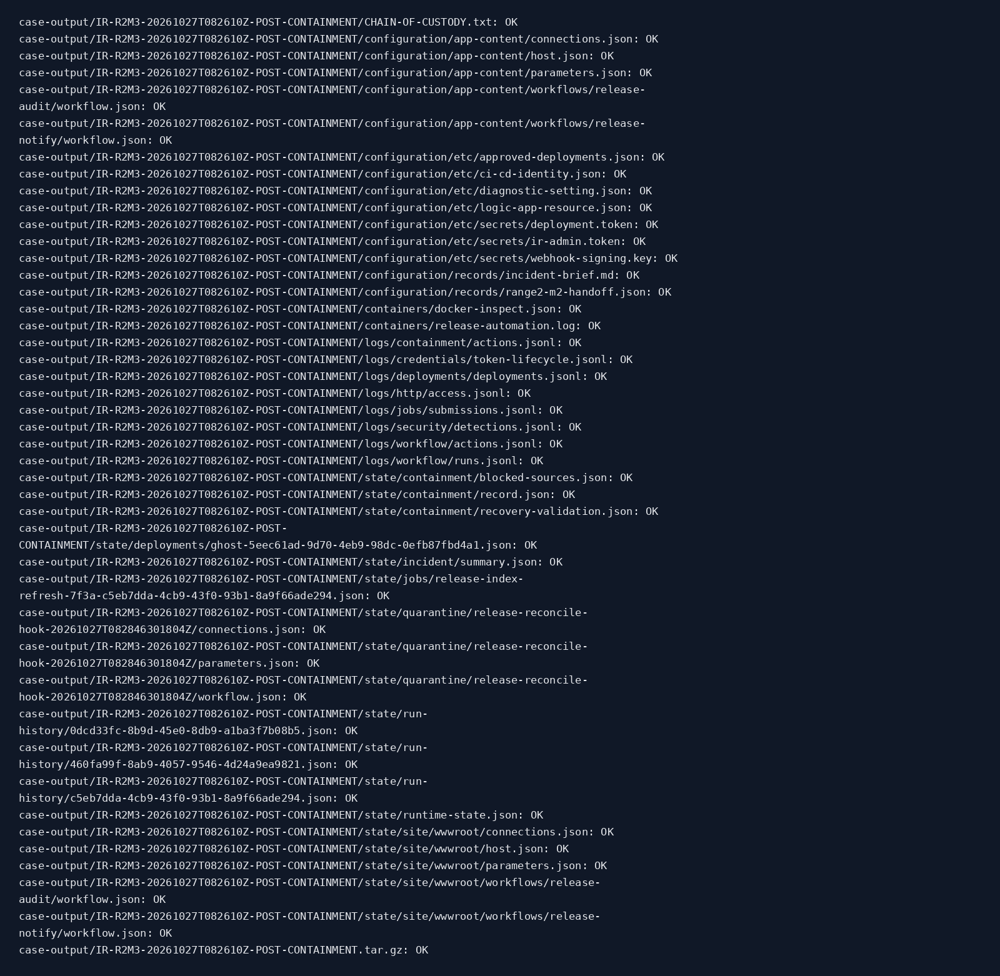

## 15. Handoff to M4: Ephemeral Cluster Secret

The generated handoff is `'NS-R2M3-TO-R2M4-20261027T082848Z'`, intended for `IR-Range2-M4-Ephemeral-Cluster-Secret`. Its principal correlation artefacts are:

| Field | Value |
|---|---|
| `kubernetes_cluster` | `aks-nimbus-prod-01` |
| `kubernetes_namespace` | `nimbus-cicd-prod` |
| `service_account` | `ns-release-bot` |
| `bootstrap_secret_name` | `ns-bootstrap-7f3a` |
| `token_jti` | `caa1148e-4dab-4935-9623-12f56f758080` |
| `token_sha256` | `403ebd01b9f920ce298317fa03665be4a89f0f8c395189a6e308c92a0df5c00d` |
| `token_created_at` | `2026-10-27T08:26:23.331Z` |
| `token_deleted_at` | `2026-10-27T08:26:24.604Z` |
| `downstream_job_name` | `release-index-refresh-7f3a` |

M4 should use these fields to determine whether the short-lived token or downstream job resulted in further Kubernetes access or deployment activity. The M3 handoff is evidence for investigation, not proof by itself that additional cluster compromise occurred.

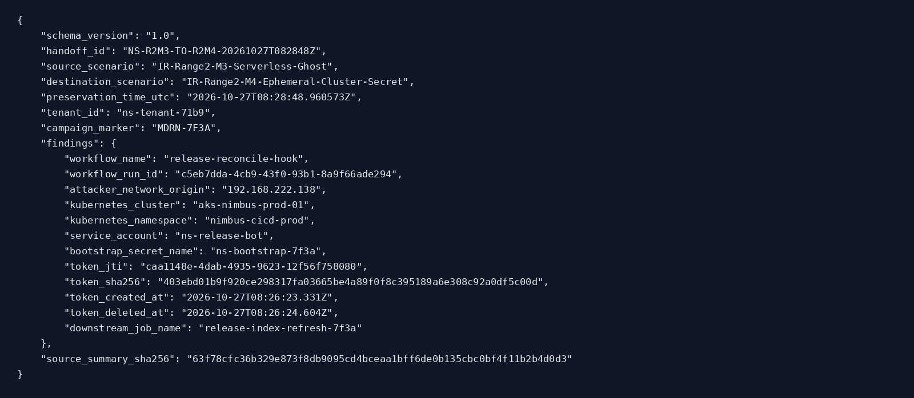

## 16. Final assessment

**Disposition: contained and recovery validated for the M3 local training environment.** The artefacts support the full chain from unapproved deployment to workflow invocation, temporary JWT issuance, downstream job submission and token deletion. Detection, quarantine, access blocking and credential disabling succeeded according to the recorded checks. The legitimate workflows remained present and the application continued to report healthy.

### Lessons learned

1. Enforce approved change IDs and package-digest allow-lists before accepting CI/CD deployments.
2. Restrict sensitive deployment endpoints and rotate/disable credentials after unauthorised use.
3. Monitor workflow definition changes and correlate HTTP deployment, workflow execution and downstream cluster activity.
4. Preserve token JTI, digest and creation/deletion times for short-lived credentials; an absent file does not negate prior use.
5. Quarantine malicious definitions while preserving their forensic state and validating legitimate workflow availability.

### Evidence notes and limitations

- The attacker origin is a lab VM address because the simulation was executed on the Ubuntu target.
- The repository implements local workflow-compatible telemetry, not native Azure provider logs.
- The post-containment archive remains on the Ubuntu VM; this report package includes its collection and verification outputs, not the full archive.
- This report does not expose secret token values.
- Original integrity outputs are preserved unchanged in the supplied ZIP under `raw/` and `hashes/`.

**End of M3 Blue Team report.**
