# IR-Range2 M4 — Ephemeral Cluster Secret

> **Publication note:** This GitHub copy contains the Blue solution and supplied images. References to raw summaries, handoff JSON, analysis artifacts, archive inventories and original hash manifests describe the original supplied ZIP or lab casework; those supporting files are not included in this copy.

**Blue Team Investigation and Recovery Report**  
**Case:** `IR-R2M4-20261027T084951Z`  
**Exercise date:** 27 October 2026 (all incident times in UTC)  
**Environment:** Authorised NimbusSphere Kubernetes incident-response lab, Ubuntu/K3s  
**Disposition:** Attack confirmed; pre-containment evidence preserved; deleted Secret recovered; containment and recovery validated; M5 handoff generated.  
**Evidence class:** Redacted, shareable case package; raw Kubernetes datastore and recovered credentials remain on the lab VM.

## 1. Executive summary

An authorised simulation exercised a compromised NimbusSphere release-reconciliation callback against a vulnerable Kubernetes automation identity in `nimbus-cicd-prod`. A successful HTTP reconciliation operation created a transient Kubernetes Secret, executed a Job as `ns-release-bot`, accessed both the in-cluster registry and collaboration APIs, then deleted the Secret. The attacker-controlled sequence was verifiable using target-side records, real Kubernetes API audit logging, preserved Job/Pod metadata, and the etcd database history. The incident was **high severity within the training scenario** because the automation identity possessed broad Secret/Job permissions, a long-lived token was available, and the workload accessed a partner collaboration location.

Evidence acquisition preceded containment. The official acquisition produced a genuine embedded-etcd snapshot, Kubernetes and bridge records, and an 86-event merged timeline. Investigators subsequently restored the snapshot into an isolated forensic etcd instance and recovered the deleted Secret at revision **1772**; both registry and collaboration credential artefacts were recoverable. Recovery checks confirmed that the exposed bridge remained disabled, the original service account and broad RoleBinding were removed, credentials rotated, the Job deleted, and a restricted replacement identity deployed.

**Scope caveat:** the user supplied the final *redacted evidence ZIP*, not the original raw snapshot, source audit log, or sealed pre-containment TAR. Their collection and checksum-verification output was supplied earlier in this conversation. The ZIP's own SHA-256 manifest was independently verified here; the raw acquisition cannot be independently re-analysed from this ZIP alone.

## 2. Investigation parameters and indicators

| Parameter | Observed value |
|---|---|
| Target/application | NimbusSphere Kubernetes Operations / release reconciliation |
| Namespace | `nimbus-cicd-prod` |
| Cluster node | `ir-r2m4-k3s` |
| Compromised identity | `ns-release-bot` |
| Secret | `ns-bootstrap-7f3a` |
| Job / Pod | `release-index-refresh-7f3a` / `release-index-refresh-7f3a-6b562` |
| Operation ID | `f54d7789-9804-467f-b234-5dc600bd0cb3` |
| Simulated source peer | `192.168.222.138` (the Ubuntu target VM itself) |
| Container image digest | `sha256:d4a33e76f296f4b470f149c3212185fe029fa19322be4751b14209ba60785d09` |
| Campaign marker | `MDRN-7F3A` |
| Partner folder | `AST-COLLAB-042` |
| Next-stage DNS indicator | `update-checker.net` |

The source peer must not be described as a separate external attacker machine: the Nuclei attack was deliberately launched on the Ubuntu target VM. Likewise, **`update-checker.net` is a next-stage indicator, not proof that DNS exfiltration occurred in M4**; M5 is intended to investigate that question.

## 3. Scope and baseline

The M4 application was deployed on a local K3s control plane with embedded etcd and API auditing. The validated pre-incident state contained ready `registry-api` and `collaboration-api` Deployments, an `ns-release-bot` automation identity with excessive permissions and a long-lived credential, and no incident Job or temporary bootstrap Secret. Secret encryption at rest was not enabled in the intended exercise configuration. Setup validation reported PASS.

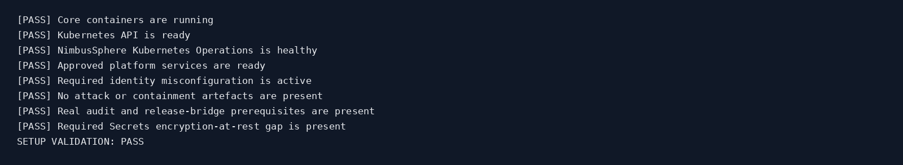

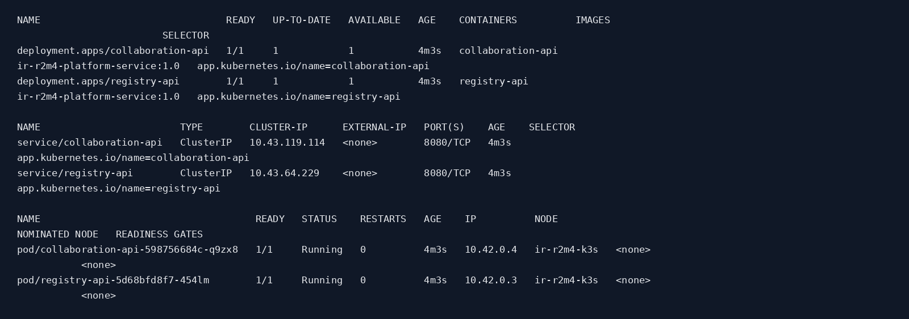

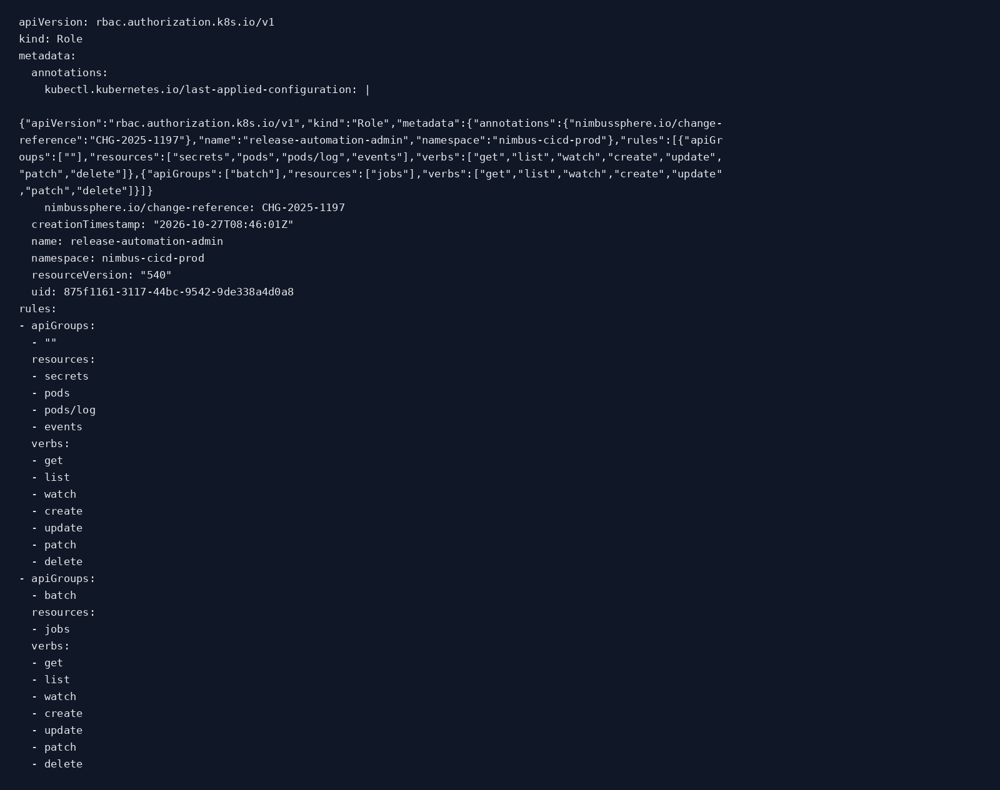

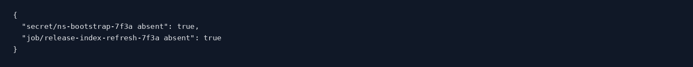

### Exposure contributing to the incident

The automation identity was allowed to create Secrets and batch Jobs in a production-styled namespace. The RoleBinding `ns-release-bot-automation-admin` represented an excessive privilege grant. The persistent service-account token broadened the consequences of credential disclosure, while the lack of etcd encryption at rest increased sensitivity of datastore access and backup handling. These are exercise misconfigurations, not findings against an external production environment.

### Additional baseline and access-control evidence

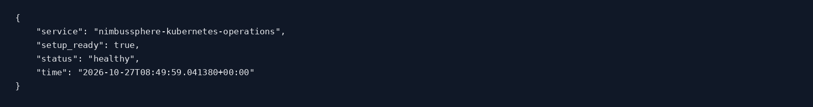

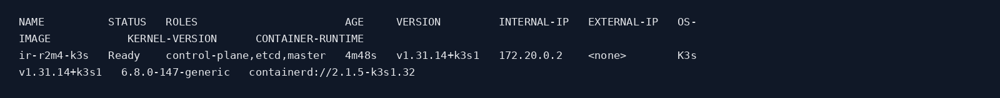

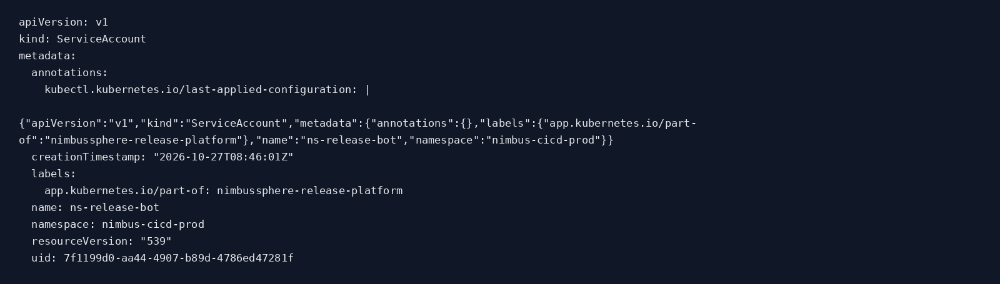

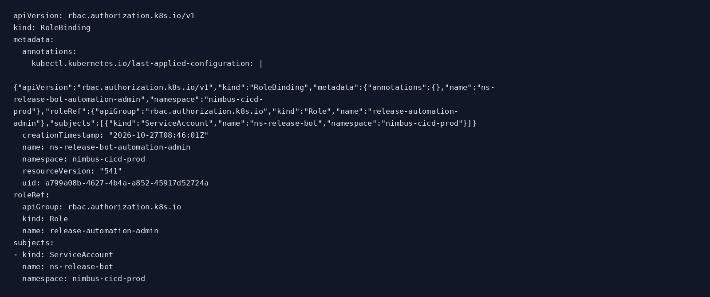

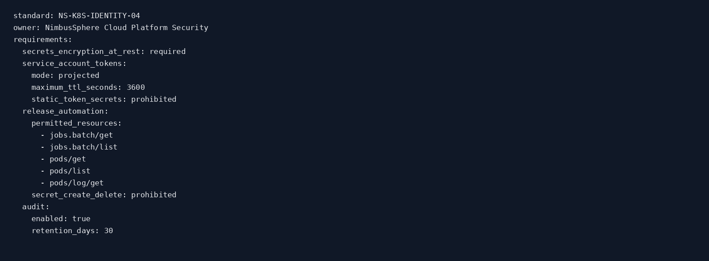

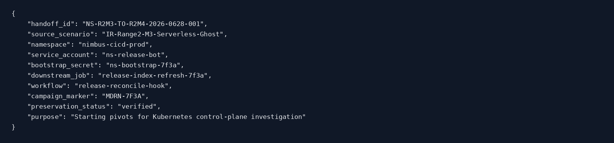

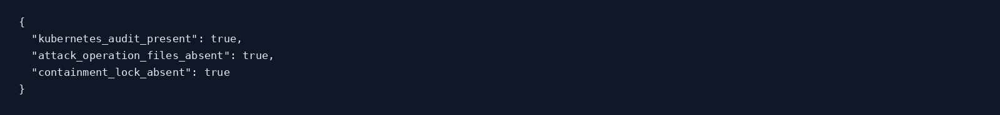

## 4. Attack execution and incident chronology

The official Nuclei scenario was executed once successfully against `192.168.222.138:32773`, following a correction to the package's attack-asset comparison logic. The successful response returned HTTP 200 and `status=completed`, operation ID `f54d7789-9804-467f-b234-5dc600bd0cb3`. Official `validate-attack.sh` subsequently passed all seven checks, including a real completed Job, downstream service traffic, Kubernetes Secret/Job audit operations and deletion-history recoverability.

| UTC date and time | Reconstructed event | Confidence / evidence |
|---|---|---|
| 08:49:51 | Case/baseline capture directory created | Baseline case name and 13 PNGs |
| 08:53:15.856349 | `ns-bootstrap-7f3a` created | Preserved operation record, handoff |
| 08:53:24.074687 | Pod logged successful registry and collaboration access | Workload log excerpt supplied in conversation |
| 08:53:28.150745 | Temporary Kubernetes Secret deleted | Preserved operation record, handoff |
| 08:53:28 | Reconciliation returned HTTP 200, completed | Nuclei HTTP evidence supplied in conversation |
| 08:57–08:58 | Preserved snapshot restored and deleted Secret recovered | Recovery output and SHA checks supplied in conversation |
| 08:58:29 onward | Containment initiated; first YAML stdin attempt interrupted | Troubleshooting and status output supplied in conversation |
| Later | Wrapper fixed; containment then recovery validated | Uploaded validation records |
| 09:13:01.465025 | Verified M4-to-M5 handoff generated | Uploaded handoff |

The Secret existed for approximately **12.29 seconds**. These times are from the captured operation record and handoff; the full 86-line merged timeline is **not** in the shareable ZIP, only its event count and schema are included.

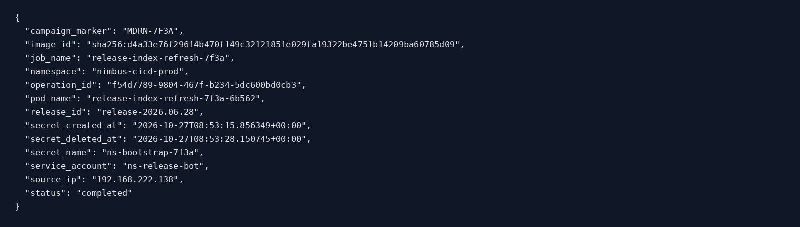

## 5. Kubernetes workload reconstruction

The unauthorised Job ran using service account `ns-release-bot` on node `ir-r2m4-k3s`, Pod IP `10.42.0.5`, and container image digest `sha256:d4a33e76f296f4b470f149c3212185fe029fa19322be4751b14209ba60785d09`. The workload log recorded `registry_access=success` and `collaboration_access=success`, linked by operation ID `f54d7789-9804-467f-b234-5dc600bd0cb3` and campaign marker `MDRN-7F3A`. It identified registry artifact `nimbussphere/release-index` (tag `2026.06`), and a collaboration manifest for **Asterion BioSystems**, folder `AST-COLLAB-042`, with Android package `com.asterion.labassist` and next-stage host `update-checker.net`.

This supports **successful internal service access**, not confirmed publication, download of arbitrary protected records, or DNS exfiltration. The registry and collaboration services were simulated in-cluster applications.

## 6. Deleted Secret: forensic recovery

The official collection generated a real embedded-etcd snapshot before remediation. The recovery utility restored this snapshot in a **separate forensic etcd container**, queried the Secret's historical key at recorded revision **1772**, and decoded expected fields from the recovered value. Both credential classes were present. The recovered values are intentionally omitted from the report and screenshots; only recovery booleans, datastore revision, folder, campaign marker and next-stage hostname are retained.

| Recovered artefact | Result |
|---|---|
| Secret name | `ns-bootstrap-7f3a` |
| etcd historical revision | `1772` |
| Registry credential | Recovered; value redacted |
| Collaboration credential | Recovered; value redacted |
| Partner folder | `AST-COLLAB-042` |
| DNS pivot | `update-checker.net` |
| Campaign marker | `MDRN-7F3A` |

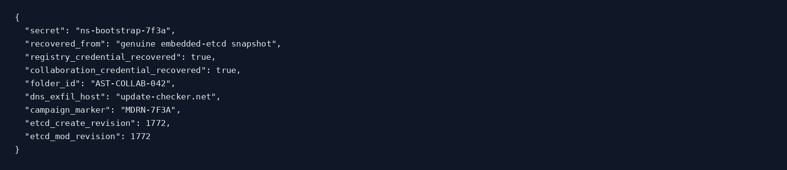

**Why this matters:** deleting a Secret removes it from the current Kubernetes API view but does not necessarily remove a version retained in etcd history or an earlier snapshot. Recovery is conditional on snapshot timing and compaction, not guaranteed indefinitely. Both the raw snapshot and decoded credentials must be treated as sensitive.

## 7. Kubernetes API audit and cross-source correlation

The supplied incident-analysis summary reports **81 extracted audit events**, and the merged timeline reports **86 events**. The redacted audit screenshot renders only a 30-event preview. Its simplified export has blank `resource`, `name` and `audit_id` fields for those records because the summary generator did not preserve the source extractor's full schema. Those blanks are **a summarisation limitation, not proof that the original Kubernetes audit log omitted resource names or IDs**.

The stronger attribution chain comes from the original official `ATTACK VALIDATION: PASS` output, the captured operation record, Pod/runtime identifiers, etcd recovery, and service-access log, which together correlate the same Secret, Job, service account, campaign marker and operation ID. For independent peer review of each Kubernetes API call, analysts should consult the locally retained `pre-containment-evidence/kubernetes-audit.log` and original extracted events; they were deliberately excluded from the shareable archive.

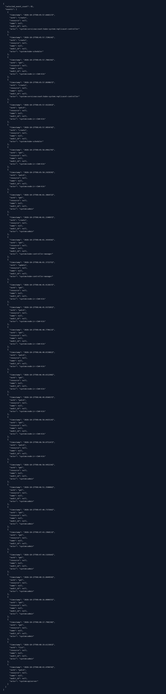

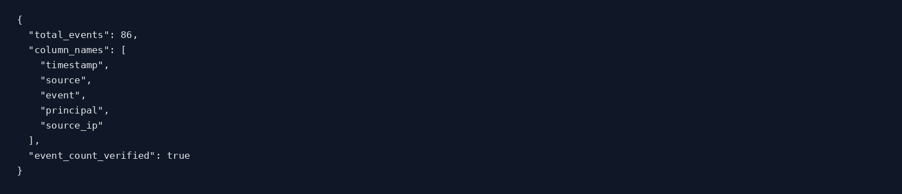

## 8. Chain of custody and evidence integrity

The original case path was `/opt/IR-Range2/M4-EphemeralClusterSecret/case-output/IR-R2M4-20261027T084951Z`. The investigator first captured a 13-image baseline; subsequently the official `collect-case.sh` acquired node, service, RBAC, event, Pod, Job, bridge, audit, and datastore records. User-supplied terminal output showed successful checksum checks for the snapshot and case TAR archive; recovered-secret JSON and etcd-record digests also passed.

The uploaded final ZIP contains **21 screenshots, 8 raw redacted investigation summaries, a structured M5 handoff plus its digest, and a SHA-256 manifest**. Independent verification of this uploaded ZIP yielded **31 of 31 manifest entries matching**, with no corrupt ZIP entries. This verification applies to the supplied shareable ZIP, not to physical custody of the VM or the locally retained raw acquisition.

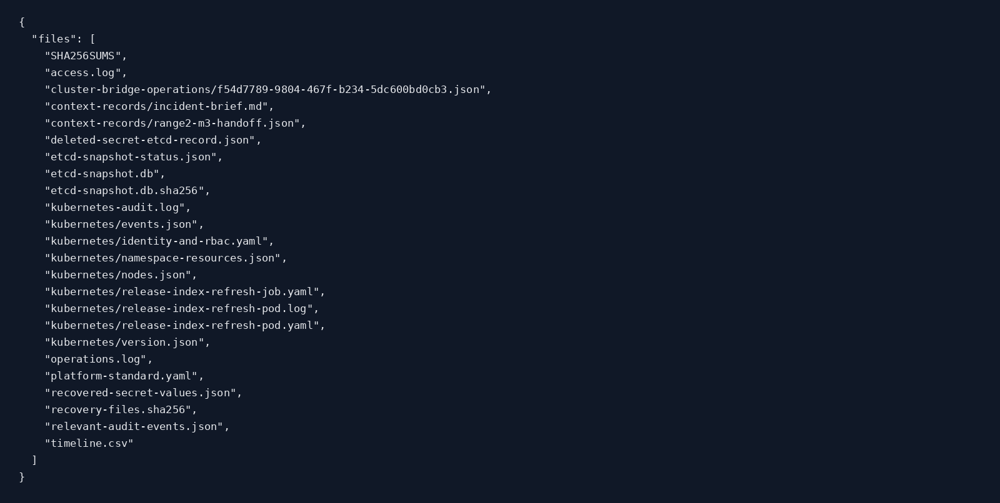

## 9. Containment, eradication and recovery

An initial containment attempt created `containment.lock` but failed at `kubectl apply -f -` because `nimbussphere-platform/operations/kubectl.sh` used `docker exec` without stdin forwarding. At the time of that failure, the old RoleBinding and identity still existed and the Job remained. Investigators confirmed the incomplete state, preserved the original wrapper and fixed the three kubectl execution paths to use `docker exec -i`. Following a dry-run, the official response and recovery scripts completed.

The successful response disabled the reconciliation callback (expected HTTP 423), removed `ns-release-bot-automation-admin`, revoked the persistent service-account token, deleted the compromised `ns-release-bot` identity and unauthorised Job, rotated the two downstream API credentials, and cordoned the node during containment. Recovery created `ns-release-bot-v2` with only observer permissions, uncordoned the node and retained the bridge block. The operations console uses a separate read-only token-backed identity.

**Containment and post-recovery validation both reported PASS**, including the blocked callback, credential rotation, removal of insecure resources, healthy approved services, and prevention of Secret creation by the new identity.

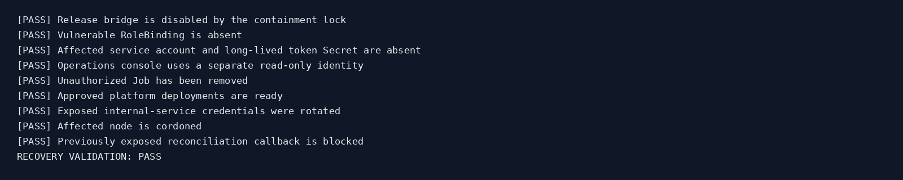

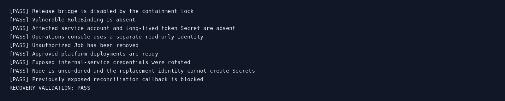

## 10. Root cause and impact assessment

**Root cause:** an overly permissive Kubernetes automation role, coupled with a persistent service-account token and an exposed reconciliation capability, permitted unauthorised creation of a temporary Secret and Kubernetes Job. The malicious lifecycle was intentionally brief, and immediate deletion could have hampered triage without immutable control-plane logs and pre-containment datastore acquisition.

**Confirmed within the exercise:** unapproved reconciliation, successful Job, Secret creation/deletion, both internal service accesses, recoverable historical credentials, and effective subsequent containment and recovery. **Not yet confirmed:** public internet data exfiltration, DNS exfiltration or compromise of the named Android application. Those are investigative leads for M5, not facts established by M4.

## 11. Recommended preventive controls

1. Eliminate persistent service-account token Secrets; use short-lived bound tokens and narrowly scoped identities.
2. Replace broad Secret/Job create-delete rights with task-specific namespace roles, and restrict deployment identity trust.
3. Enforce release-change authorisation and single-purpose callback credentials; isolate administrative reconciliation endpoints.
4. Enable and test Kubernetes audit logging with tamper-resistant export, retention and alerting on rapid Secret create/delete and suspicious batch Job creation.
5. Encrypt etcd Secrets at rest; restrict backup and snapshot access, apply secret-safe retention and key rotation.
6. Monitor unusual Pod egress and cross-service authentication in the release namespace; correlate network, job and API identities.
7. Test restoration and incident response runbooks, including validation of stdin-preserving kubectl wrappers for applied manifests.

## 12. M4 → M5 handoff

The official handoff was generated at `2026-10-27T09:13:01.465025+00:00` and locally validated with `Handoff verification: PASS`. Its canonical SHA-256 value was also independently checked from the provided handoff JSON and matched `record_sha256`.

| Field | Handoff value |
|---|---|
| Destination | `IR-Range2-M5-DNS-Exfil-Confirmation` |
| Operation ID | `f54d7789-9804-467f-b234-5dc600bd0cb3` |
| Runtime Pod | `release-index-refresh-7f3a-6b562` |
| Image digest | `sha256:d4a33e76f296f4b470f149c3212185fe029fa19322be4751b14209ba60785d09` |
| Collaboration folder | `AST-COLLAB-042` |
| DNS indicator | `update-checker.net` |
| Campaign | `MDRN-7F3A` |
| Handoff record hash | `d0bbc5c0843479f800cbf8b89f462f8a5fcd1755b955683a53840ee72911e78e` |

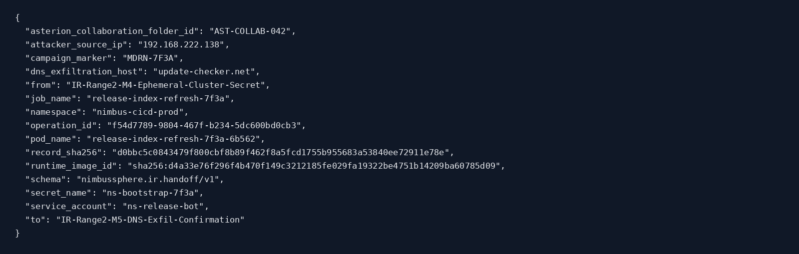

### M5 investigative starting questions

Investigate whether the DNS indicator was queried by the relevant workload or another component; whether it carried encoded data or simply resolved a host; which source IP and process originated any queries; and whether outbound events correlate to Asterion collaboration activity. Confirm with DNS server logs, network flow or packet evidence, not merely the presence of a hostname in the recovered Secret.

## 13. Appendix: shareable exhibit index

All 21 clean PNG exhibits are in `images/`. Figures **01–13** document the baseline and RBAC condition; **14** is the recovered Secret summary; **15** is the reconciliation operation; **16** is the limited audit preview; **17** lists preserved evidence; **18–19** document containment and recovery; **20** is the M5 handoff; **21** summarises timeline counts. The original supplied ZIP also contains raw redacted text summaries in `raw/`, the handoff in `handoff/`, and file hashes in `hashes/`.

**Final disposition:** **Contained and recovered; M5 investigative handoff ready.** No raw credential values are included in this report.
