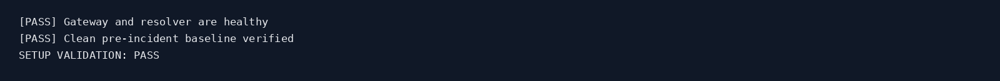
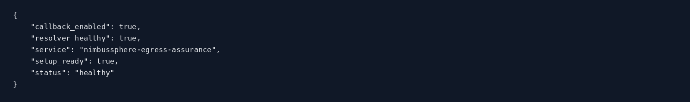
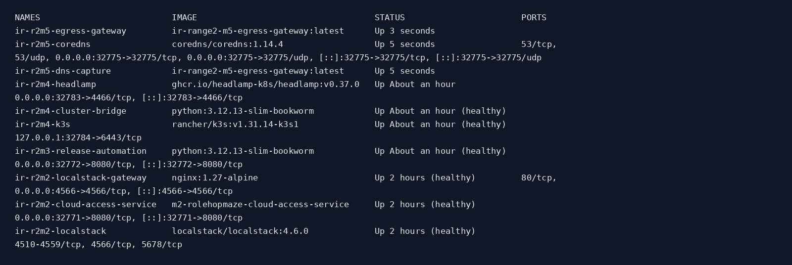
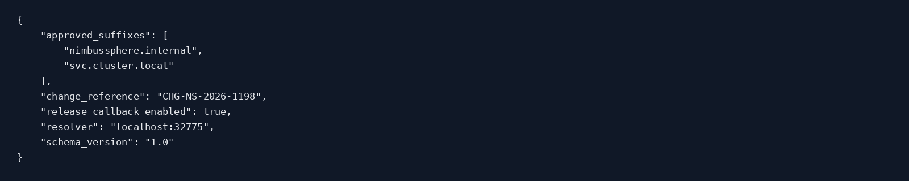
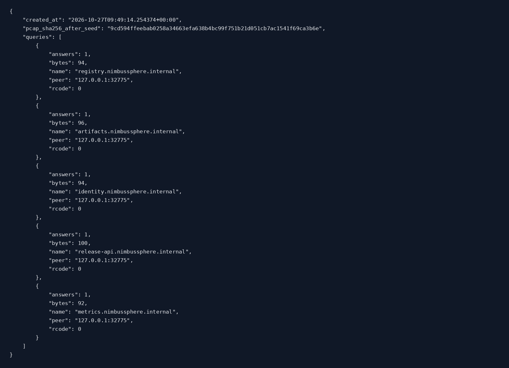
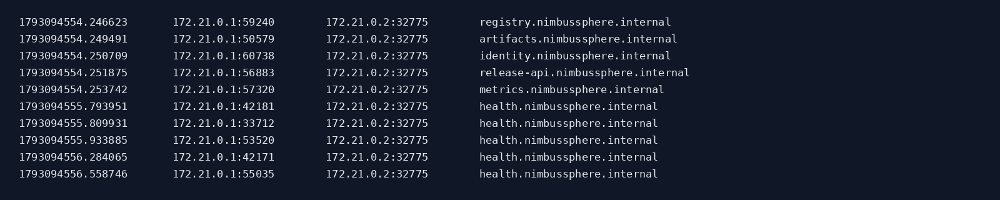
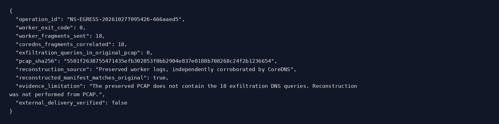
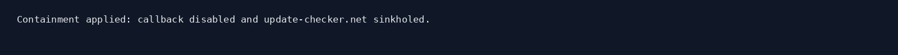
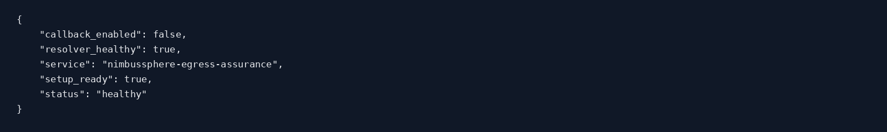
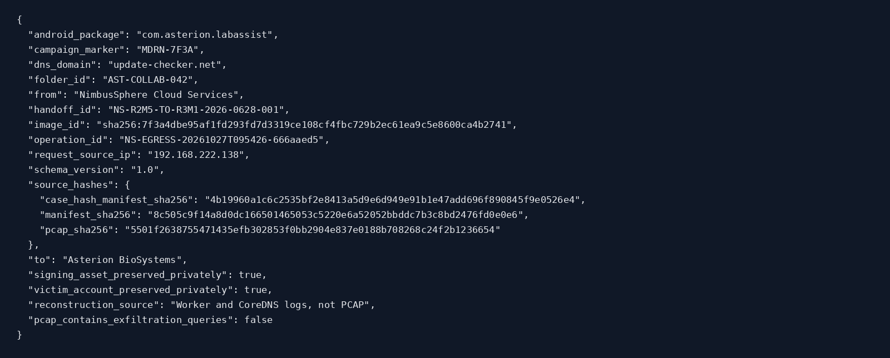

# IR Range 2 — Machine 5: DNS Exfil Confirmation

> **Publication note:** This GitHub copy contains the Blue solution and supplied images. References to raw summaries, handoff JSON, analysis artifacts, archive inventories and original hash manifests describe the original supplied ZIP or lab casework; those supporting files are not included in this copy.

**NimbusSphere Egress Assurance | Blue Team Incident Response Report**  
**Case:** `IR-R2M5-20261027T094832Z`  
**Incident operation:** `NS-EGRESS-20261027T095426-666aaed5`  
**Investigation date:** 27 October 2026 (all timeline times UTC unless noted)  
**Disposition:** Simulated DNS transmission confirmed by worker and CoreDNS logs; original PCAP capture gap; contained and recovery validation passed.  
**Evidence level:** Authorised cyber-range lab, not a real-world exfiltration finding.

## 1. Executive summary

The fifth IR-Range2 machine investigates the downstream activity following the M4 Kubernetes Secret and workload compromise. The simulated NimbusSphere egress gateway accepted a reconciliation request associated with campaign `MDRN-7F3A` and dispatched a short-lived Docker worker. The worker reported successful completion (exit code `0`) and emitted **18 encoded DNS query fragments** under `update-checker.net`. The investigator's Ubuntu-side log reconstruction recovered the manifest, matched it exactly to the lab's original Asterion transfer manifest, and independently correlated all 18 query names with CoreDNS output.

However, the **original and live PCAPs contained zero matching exfiltration queries**; both copies had SHA-256 `5501f2638755471435efb302853f0bb2904e837e0188b708268c24f2b1236654`. Accordingly, the payload was **not reconstructed from captured packets**, nor is external delivery demonstrated. The original operation's `worker_ip` field was also blank, causing official `validate-attack.sh` to fail despite the worker's exit code of zero. Both limitations are part of the investigation record rather than being silently corrected.

The response disabled the reconciliation callback, sinkholed `update-checker.net`, and completed the official recovery validation. A qualified M5-to-Range3 handoff was generated and verified, with sensitive assets retained in the private case directory.

**Outcome:** The simulation and log-derived reconstruction are validated; packet-based confirmation remains incomplete. This is an evidence-source limitation, not proof of absent DNS traffic.

## 2. Case scope and systems

| Item | Observed value |
|---|---|
| Tenant/service | NimbusSphere Egress Assurance |
| Gateway | TCP `32774` |
| CoreDNS | UDP/TCP `32775` |
| Docker network | `ir-r2m5-dns-data` |
| Campaign | `MDRN-7F3A` |
| Operation | `NS-EGRESS-20261027T095426-666aaed5` |
| Reconciliation request source | `192.168.222.138` (the same Ubuntu lab VM that ran the authorised simulation) |
| DNS suffix | `update-checker.net` |
| Customer collaboration folder | `AST-COLLAB-042` |
| Android application identifier | `com.asterion.labassist` |
| Pre-containment PCAP hash | `5501f2638755471435efb302853f0bb2904e837e0188b708268c24f2b1236654` |

The scope is the controlled cyber-range environment. The source IP identifies the actual accepted network peer for the simulation, **not** a separate external attack system. The external-looking DNS name is a scenario destination; actual off-lab delivery is not substantiated by the supplied evidence.

## 3. Chain of custody and integrity

The supplied `M5-Investigation-Screenshots.zip` was opened successfully, its CRC test passed, and all **24 files referenced by `hashes/M5-INVESTIGATION-SHA256SUMS`** matched their SHA-256 checksums. It contains **11 PNG screenshots**, **12 raw text summaries** (one, `07-attack-validation.txt`, is empty), one redacted handoff JSON and the manifest. The included PNGs are command-output-style screenshots rather than terminal prompt captures.

During the Ubuntu investigation, a separate raw acquisition was verified at `private/failed-worker-acquisition/`, and a log-derived reconstruction was independently hashed in `private/log-derived-reconstruction/`. Those raw case directories, including PCAP and original worker/CoreDNS logs, **are not included in this shareable ZIP**. Their findings are included here using the output confirmed in the investigation conversation and the exported redacted forensic summary. Maintain the private originals for audit or subsequent re-analysis.

## 4. Initial baseline and policy

The starting gateway health response reported `setup_ready=true`, `resolver_healthy=true`, and `callback_enabled=true`. M5 setup and clean-baseline validation passed. The approved destination suffixes were `nimbussphere.internal` and `svc.cluster.local`, governed by change reference `CHG-NS-2026-1198`. `update-checker.net` was not an approved suffix.

The baseline packet extraction showed internal service lookups including `registry.nimbussphere.internal`, `artifacts.nimbussphere.internal`, `identity.nimbussphere.internal`, `release-api.nimbussphere.internal`, and `metrics.nimbussphere.internal`; health checks followed. Before the incident, no campaign worker or incident operation was expected.

## 5. Chronology

| UTC time | Evidence-based event |
|---|---|
| 09:49:11–09:49:14 | DNS capture service started; baseline state generated at `09:49:14.254374Z`. |
| 09:54:26 | Operation `NS-EGRESS-20261027T095426-666aaed5` created and worker started (Docker start time `09:54:26.730668855Z`). |
| 09:54:28.205 | Worker `worker_started`, reporting 18 fragments. |
| 09:54:28.217–09:54:30.330 | Worker emitted 18 sequential DNS fragments, each returning response code 0. |
| 09:54:30.451 | Worker emitted `worker_completed` with `fragments_sent=18`. |
| 09:54:30.493 | Docker recorded worker finish, exit code 0. |
| After acquisition and reconstruction | Manifest comparison and independent CoreDNS correlation passed; raw case hashes verified. |
| After preservation | Reconciliation callback disabled, domain sinkholed, recovery validation passed. |

This timeline combines recorded worker/Docker timestamps and the investigation's validation outputs. The shareable ZIP does not contain the underlying unredacted logs or a complete machine-generated timeline; retain original logs for detailed correlation.

## 6. Attack activity and forensic attribution

The authorised Nuclei flow targeted the local gateway's readiness and reconciliation endpoints. A campaign-labelled worker was created in Docker and used a source manifest stored at the Asterion collaboration path. The operation record reported `status=completed` and Docker `exit_code=0`. The individual worker log events explicitly accounted for sequences 1 through 18 and `worker_completed`.

**Official validator failure:** `validate-attack.sh` failed while parsing the operation JSON because the `runtime.worker_ip` field was empty. A subsequent direct Docker inspection confirmed the container finished successfully, with no OOM kill. The investigation did not fabricate a worker address or rewrite the original runtime record. The independently recovered logs and DNS evidence must remain separately attributed.

**DNS source evidence:** Worker logs listed 18 encoded query names and successful DNS response codes; all 18 names appeared in CoreDNS logs. This corroborates transmission to the lab resolver. It does not independently demonstrate Internet egress.

## 7. DNS reconstruction and key analysis

The worker generated 18 DNS subdomains using an ordered fragment scheme. The investigator extracted the image-embedded XOR key via the official `extract_worker_key.sh`, reconstructed the encoded fragment stream from the preserved worker log, decoded it, and parsed the recovered JSON manifest. The recovered JSON matched the lab's original `transfer-manifest.json` exactly.

**Verified log-derived outcome:** 18/18 fragment sequences, 18/18 CoreDNS-correlated names, exact original-manifest comparison. The recovered metadata included Asterion folder `AST-COLLAB-042`, Android package `com.asterion.labassist` and marker `MDRN-7F3A`. Signing-asset and victim-account fields were preserved privately, not displayed in the shareable evidence.

**PCAP limitation:** The original 3,087-byte PCAP contained 12 internal DNS queries but no queries ending in `update-checker.net`. The live PCAP had the same SHA-256 and likewise contained zero exfiltration-domain queries. The packet-capture container was running, had zero restarts and bound to `br-r2m5dns`. This mismatch is a capture visibility / network path issue requiring follow-up. It must not be repaired by injecting reconstructed packets into the original evidence.

## 8. Root cause and risk analysis

The scenario combines a stale release-reconciliation callback credential, the gateway's ability to launch a Docker worker, DNS egress that was not constrained to the approved suffixes, and encoding material recoverable from the worker image. Together these enabled a short-lived, campaign-labelled worker to encode Asterion data into resolver queries.

The observation demonstrates **control gaps in automation trust, Docker Engine access and DNS egress policy**. It does not establish that any real-world credential or customer data was compromised outside the controlled lab. In addition, packet capture did not observe the simulated exfiltration sequence, producing a material detection-engineering and evidence-preservation gap.

## 9. Containment and recovery

After evidence preservation and reconstruction, the official `apply-containment.sh` reported that the reconciliation callback was disabled and `update-checker.net` was sinkholed. The official `validate_recovery.py` returned `RECOVERY VALIDATION: PASS`. The post-containment health endpoint showed `callback_enabled=false`, while resolver health and setup readiness remained true.

## 10. Handoff to Range 3 / Asterion

The official `generate_handoff.py` produced `range2-m5-to-range3-handoff.json`, and `verify_handoff.py` returned `HANDOFF VALIDATION: PASS`. The redacted handoff in this package records operation ID, source IP, Asterion folder, Android package, campaign, domain and original evidence hashes.

The handoff includes the original PCAP checksum, but **that checksum does not imply the PCAP contains the 18 fragments**. The supplementary reconstruction source and capture limitation must accompany any escalation to Range 3. Sensitive signing-asset and victim-account fields remain in the privately preserved full handoff.

## 11. Recommended improvements

1. **Improve packet-capture coverage:** capture on the actual worker-to-resolver network path, confirm source attribution and compare packets with resolver logs. Test the change using a new, separately identified run rather than altering this case's evidence.
2. **Constrain DNS egress:** block or sinkhole unapproved suffixes by default, with policy enforcement beyond DNS logging alone.
3. **Protect release automation:** revoke stale callback tokens, require expiring scoped credentials, and limit gateway access to the Docker Engine.
4. **Remove secrets from images:** supply short-lived secrets through a managed mechanism and rotate any image-baked keys exposed during an incident.
5. **Fix telemetry correctness:** preserve network source metadata separately from mutable Docker inspection results; handle a missing `worker_ip` as a reportable visibility problem instead of concealing it.
6. **Preserve chain of custody:** keep the original PCAP, Docker inspect metadata, CoreDNS output, worker stdout and hashes, plus the redacted Range3 handoff, as distinct artefacts.

## 12. Final assessment

**Contained and recovered:** Yes, on the official M5 response and recovery checks.  
**Manifest reconstruction:** Verified from original worker log fragments, corroborated by CoreDNS and compared with the lab manifest.  
**PCAP-based reconstruction:** **Not verified**; the captured packets do not contain exfiltration queries.  
**External DNS delivery:** **Not verified**.  
**Range3 handoff:** Official schema validation passed, with an explicit evidence-source limitation.  
**Case status:** Closed for this authorised simulated run, with packet-capture reliability retained as an unresolved engineering finding.

---

### Report evidence index

The shareable archive contains the original 11 PNGs in `images/`, command-output excerpts in `raw/`, `handoff/redacted-m5-to-range3-handoff.json` and `hashes/M5-INVESTIGATION-SHA256SUMS`. The absence of PNGs for steps 07–15 reflects the supplied export; the report does not invent screenshots. Raw PCAP, unredacted worker/CoreDNS logs, private key, reconstructed manifest and full sensitive handoff must be retrieved from the user's Ubuntu casework if needed for follow-up investigation.
